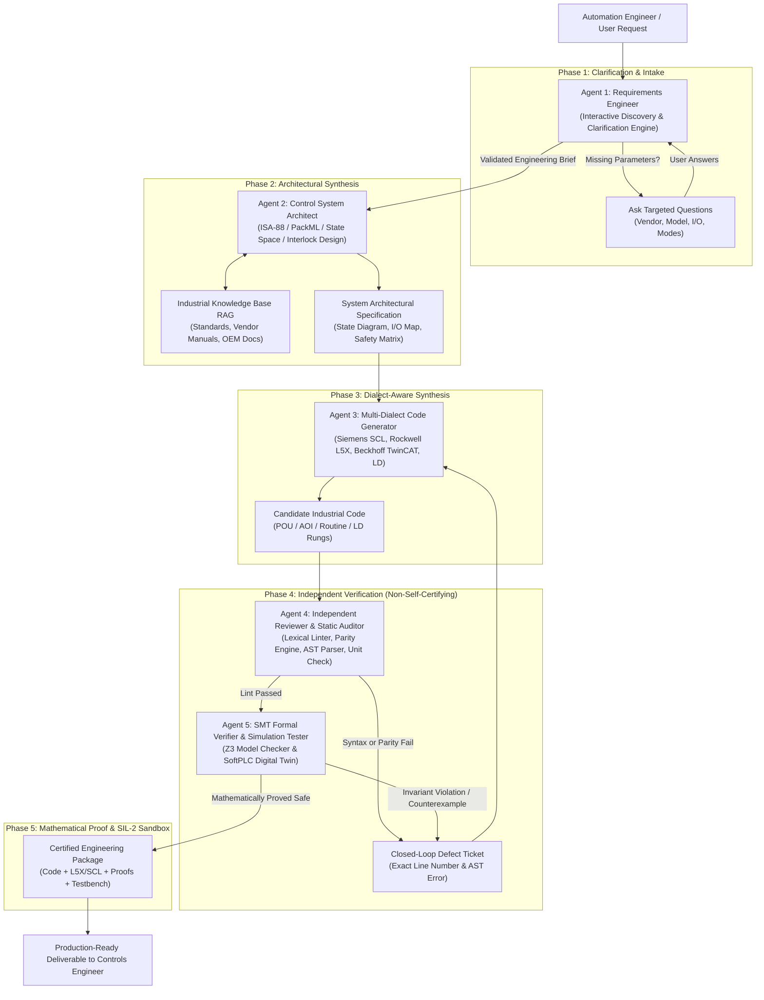

# AGENTIC_ENGINEERING_WORKFLOW.md — Multi-Agent Engineering Architecture

**Document Version**: 2.0.0  
**Classification**: Agentic Workflow, Multi-Agent Orchestration & Systems Engineering Protocol  
**System**: Lumina Industrial PLC Code Intelligence & Synthesis Platform  
**Author**: Principal Software Architect & Multi-Agent Systems Lead  
**Date**: November 23, 2026  
**Status**: ACTIVE & LIVING ENGINEERING WORKFLOW SPECIFICATION  

---

## 1. Executive Summary & Core Engineering Principle

In compliance with Section 5 of the Master Instruction:
> **"Separate planning, retrieval, code generation, independent review and validation responsibilities. Do not rely on an LLM to certify its own code."**

A single LLM prompt cannot simultaneously serve as requirements analyst, software architect, code generator, security auditor, and safety verifier. LLM self-evaluation is prone to confirmation bias, overlooking its own uninitialized variables, inverted Boolean logic, and race conditions.

The Lumina Industrial Platform implements a **5-Agent Asynchronous Engineering Assembly Line** where each agent possesses distinct tools, system personas, operational boundaries, and deterministic verification gates.

---

## 2. Multi-Agent Role Architecture



---

## 3. Detailed Agent Specifications

### 3.1 Agent 1: Requirements Engineer (Discovery & Clarification)
- **Primary Persona**: Senior Industrial Systems Analyst.
- **Responsibilities**:
  1. Inspects raw user request for critical manufacturing parameters: Target PLC Vendor (Siemens, Rockwell, Beckhoff, CODESYS), Controller Model (e.g. S7-1516, ControlLogix 1756-L83E), programming language dialect, physical I/O mapping, operating modes (Manual, Step, Auto), cycle time constraints, and Safety Integrity Level (SIL).
  2. If any essential parameter is absent, **halts synthesis and prompts the user with targeted clarification questions** (refer to `PLC_DOMAIN_INTELLIGENCE.md` Section 5).
  3. Outputs an authoritative, unambiguous **Validated Engineering Brief (VEB)**.
- **Tools**: `clarification_engine`, `io_map_extractor`, `vendor_platform_selector`.

### 3.2 Agent 2: Control System Architect (System Design)
- **Primary Persona**: Cyber-Physical Systems Chair & Industrial Control Fellow.
- **Responsibilities**:
  1. Ingests the Validated Engineering Brief from Agent 1.
  2. Queries the Industrial Standards RAG for relevant international standards (ISA-88 for batch, PackML for machine sequencing, ISA-18.2 for alarms, ISO 13849 for safety).
  3. Formulates:
     - Discrete State-Space Model ($A, B, C, D$) and Model Predictive Control (MPC) parameters.
     - Two-out-of-Three (2oo3) TMR sensor redundancy architecture and discrepancy timing.
     - Finite State Machine (FSM) state transition diagram and fault sink states.
     - Interlock permissive matrix and physical safety boundaries.
- **Tools**: `rag_standards_query`, `state_space_designer`, `fsm_graph_builder`, `tmr_voting_calculator`.

### 3.3 Agent 3: Multi-Dialect Code Generator (Synthesis Engine)
- **Primary Persona**: Lead PLC Firmware Developer & Multi-Vendor Dialect Specialist.
- **Responsibilities**:
  1. Ingests the Architectural Specification from Agent 2.
  2. Synthesizes dialect-compliant industrial code tailored strictly to the target vendor:
     - **Siemens SIMATIC**: SCL source code, Optimized Data Blocks, UDT definitions.
     - **Rockwell Automation**: Studio 5000 `.L5X` XML, Add-On Instructions (AOI), Relay Ladder Logic (RLL).
     - **Beckhoff Automation**: TwinCAT 3 `.TcPOU` XML, ADS tag mapping, PLCopen motion FBs.
     - **CODESYS / Schneider**: IEC 61131-3 3rd edition Structured Text with memory alignment.
  3. Enforces bracketed physical engineering units (`[bar]`, `[deg C]`, `[kN]`, `[ms]`, `[m/min]`) on all declared analog process variables.
- **Tools**: `scl_dialect_emitter`, `l5x_xml_synthesizer`, `twincat_pou_generator`, `ladder_rung_builder`.

### 3.4 Agent 4: Independent Reviewer & Static Auditor (Non-Self-Certifying)
- **Primary Persona**: Independent Software Quality Assurance Auditor (ISO 9001 / TickIT).
- **CRITICAL OPERATIONAL CONSTRAINT**: Agent 4 operates under completely separate memory and process isolation. It does NOT generate code; its sole purpose is finding flaws.
- **Verification Gates**:
  1. **Structural Parity**: Exact balance of `IF/END_IF;`, `CASE/END_CASE;`, `FOR/END_FOR;`.
  2. **Lexical Linting**: Variable completeness (detecting any variable used in logic but omitted from `VAR` declarations), duplicate tag names, and illegal keywords.
  3. **Vendor Compliance**: Verifies that Rockwell-specific instructions (`GSV`/`SSV`) do not appear in Siemens code, and that Siemens-specific pointers do not appear in Rockwell logic.
  4. **Physical Bounds**: Executes Rules H1–H5 (thermal, pressure, cycle time bounds).
- **Tools**: `validate_iec_engine`, `validate_domain_engine`, `validate_semantic_engine`, `ast_variable_auditor`.

### 3.5 Agent 5: SMT Formal Verifier & Simulation Tester
- **Primary Persona**: Formal Verification Fellow & Digital Twin Simulation Engineer.
- **Responsibilities**:
  1. Translates candidate logic and safety invariants into formal Z3 SMT Boolean/BitVector constraints.
  2. Solves for invariant violations:
     $$\exists \text{ State } s : \text{Logic}(s) \land \neg \text{SafetyInvariant}(s)$$
  3. If a counterexample is found (e.g., clamp cylinder activates while safety light curtain is broken), halts execution and emits a detailed counterexample trace to Agent 3 for automated repair.
  4. Ingests candidate logic into the SoftPLC kinematic digital twin sandbox, executing 1,000 virtual scan cycles under simulated load, measuring step response and stability.
- **Tools**: `z3_smt_model_checker`, `softplc_simulation_sandbox`, `kinematic_digital_twin`.

---

## 4. Closed-Loop Repair Iteration Protocol

When Agent 4 (Static Auditor) or Agent 5 (SMT Verifier) flags a violation, the system does not produce an incomplete error message to the user. It initiates an internal closed-loop repair cycle (maximum 3 iterations):

```
Iteration Cycle:
[Candidate Code] -> [Agent 4 / 5 Fail] -> [Formal Defect Diagnostic] -> [Agent 3 Repair] -> [Agent 4 / 5 Re-Audit]
```

1. **Defect Ticket Formulation**:
   - Exact line number and code token.
   - Formal violation category (e.g. `H4_MATRIX_DIMENSION_MISMATCH`, `SMT_INVARIANT_BREACH`, `IEC_PARITY_UNBALANCED_IF`).
   - Counterexample trajectory (e.g., `Initial State: {ClampOpen: True, PartPresent: False} -> Event: StartCmd -> Failure: CylinderExtendsWithoutPart`).
2. **Targeted Repair**:
   Agent 3 ingests the defect ticket and generates a surgical patch rather than rewriting the entire program from scratch, preserving architectural stability.
3. **Escalation**:
   If the repair loop does not converge in 3 iterations, the platform generates a comprehensive engineering diagnostic report highlighting the exact mathematical conflict to the human controls engineer.
