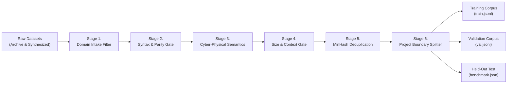
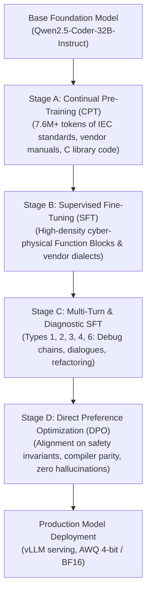

# DATASET_AND_FINETUNING_STRATEGY.md — Dataset Engineering & Fine-Tuning Strategy

**Document Version**: 2.0.0  
**Classification**: Machine Learning Engineering & Data Governance Blueprint  
**System**: Lumina Industrial PLC Code Intelligence & Synthesis Platform  
**Author**: Principal AI Research Scientist & Controls Engineering Fellow  
**Date**: November 23, 2026  
**Status**: ACTIVE & LIVING DATASET AND TRAINING SPECIFICATION  

---

## 1. Executive Summary & Data Governance Mandates

High-performance domain-specific models cannot be built on generic web code or unstructured code dumps. Industrial PLC programming requires absolute mathematical rigor, physical unit consistency, syntax perfection, and strict adherence to industrial standards.

### Non-Negotiable Data Governance Policies
1. **Zero Data Destruction**: All historical datasets (including the 870 original production datasets in `data/swarm_raw/`) remain 100% bit-level preserved in perpetuity.
2. **Never Promote Unverified Code to Ground Truth**: No synthetic code is ever ingested into the training corpus without passing the 4-stage automated validation engine (Domain, Syntax, Semantics, and Safety).
3. **Strict Train/Test Contamination Barrier**: Splitting is performed strictly at the **underlying project, plant, and system boundary** rather than by random sample shuffling. A model must never be evaluated on a Function Block or equipment cell derived from the same project repository as its training data.
4. **Preservation of High-Token / High-Context Assets**: Massive controllers ($100\text{k}$ to $700\text{k}+$ characters) containing discrete state-space matrices, Model Predictive Control (MPC) horizons, Two-out-of-Three (2oo3) TMR voting logic, and multi-tier alarms are preserved intact and trained using native high-context architectures.

---

## 2. The 10 Dedicated Dataset Archetypes

To transform the foundation model into an elite industrial automation engineering assistant, the training corpus is engineered across 10 specialized functional categories:

| Archetype ID | Dataset Archetype | Primary Role & Capability | Target Volume | Primary Use Case |
|---|---|---|:---:|---|
| **DS-01** | Industrial Manufacturing Conversations | Multi-turn consultative automation dialogue | 1,500 conversations | Field support bots, engineering consultation |
| **DS-02** | PLC Engineering Q&A Pairs | Deep technical question-answering with standards citations | 2,500 pairs | Knowledge retrieval, design trade-offs |
| **DS-03** | Verified PLC Code Generation | Monolithic and modular Function Block synthesis | 2,000 blocks | Greenfield code synthesis, standard libraries |
| **DS-04** | PLC Debugging & Code Correction | 3-turn diagnostic chains: symptom $\rightarrow$ root cause $\rightarrow$ verified fix | 1,200 chains | Compiler triage, runtime fault resolution |
| **DS-05** | Manufacturing Process Reasoning | Step-by-step causal derivations and physics modeling | 1,000 derivations | Concept-to-code translation, control design |
| **DS-06** | PLC Architecture & Refactoring | Modernizing legacy logic, adding modularity and UDTs | 1,000 tasks | Brownfield modernization, technical debt cleanup |
| **DS-07** | Industrial Troubleshooting | Fieldbus, drive, and I/O diagnostic error resolution | 1,500 scenarios | Maintenance diagnostics, fault recovery |
| **DS-08** | Safety & Validation Scenarios | IEC 61508 / 62061 SIL-2/3 Safety Instrumented Functions | 800 certified SIFs | High-integrity interlocks, E-Stop logic |
| **DS-09** | Vendor-Specific Programming | Siemens SCL, Rockwell Studio 5000 L5X, Beckhoff TwinCAT | 2,500 programs | Vendor dialect mastery, XML AST generation |
| **DS-10** | Negative Examples & Edge Cases | Intentionally flawed code paired with safety critiques | 1,000 pairs | DPO alignment, safety guardrails |

---

## 3. Schema Specifications & Generation Standards

### 3.1 Unified Schema v2.0 Standard
All dataset entries across all 10 archetypes conform to the structured **Schema v2.0** format:

```json
{
  "id": "uuid4_string",
  "schema_version": "2.0",
  "archetype": "DS_04_DEBUGGING",
  "provenance": {
    "source_type": "synthetic_verified",
    "generator_engine": "lumina_evol_v2",
    "generation_timestamp": "2026-11-23T18:00:00Z",
    "verification_gauntlet_run": "PASS_Z3_SMT_PROVED"
  },
  "industrial_metadata": {
    "sector": "automotive",
    "subsector": "bike_motorcycle_manufacturing",
    "system": "Motorcycle_TubularFrame_RoboticWeld",
    "equipment_type": "Multi_Axis_Welding_Jig",
    "target_vendor": "Rockwell_Automation",
    "target_platform": "Studio_5000_Logix_v34",
    "target_language": "Structured_Text_L5X",
    "sil_rating": "SIL_2"
  },
  "content_metrics": {
    "char_count": 185420,
    "token_estimate": 59812,
    "has_state_space_matrices": true,
    "matrix_dimension": "8x8",
    "has_mpc": true,
    "mpc_horizon": 15,
    "has_tmr_voting": true,
    "has_isa18_alarms": true,
    "fsm_states_count": 14
  },
  "messages": [
    { "role": "system", "content": "..." },
    { "role": "user", "content": "..." },
    { "role": "assistant", "content": "..." }
  ]
}
```

---

## 4. End-to-End Dataset Processing Pipeline

The dataset processing infrastructure operates in six sequential, automated stages:



### 4.1 Stage 1: Domain Intake Filter (`validate_domain.py`)
- Scans `FUNCTION_BLOCK` identifiers and content tokens against **220+ sanctioned keywords** across 7 approved manufacturing sectors: Automotive & Bike Manufacturing, Electronics & SMT, Heavy Machinery & Stamping Hardware, Semiconductor Packaging, Plastics & Polymers, Food & Beverage, and Metallurgy / Strip Steelmaking.
- Strictly rejects any block containing keywords from forbidden domains (marine, pharma, defense, oil/gas, power generation, mining, datacenter).
- Disambiguates plant equipment false positives (e.g. `MarineVessel` prevents industrial autoclave pressure vessels from being rejected; `PharmaCleanSteam` preserves food & beverage clean steam SIP loops).

### 4.2 Stage 2: Structural Syntax Parity Validator (`validate_iec.py`)
- Dual-layer markdown code fence unwrapping.
- Pre-sanitization stripping of block comments `(* ... *)` and string literals `'...'` prior to token counting.
- Word boundary isolation (`\b(?<!END_)(?<!ELS)IF\b` vs `\bEND_IF\b`) preventing compound variable false matches.
- Physical engineering units verification: requires $\ge 5$ bracketed units (`[bar]`, `[deg C]`, `[kN]`, `[ms]`, `[m/min]`).

### 4.3 Stage 3: Cyber-Physical Semantics Validator (`validate_semantic.py`)
- **Variable Completeness**: Audits all `VAR`, `VAR_INPUT`, `VAR_OUTPUT` blocks; flags declared variables $< 10$ and reports duplicate variable names.
- **State-Space Matrix Geometry**: Verifies that state transition matrix $A$ is square ($n \times n$) and input matrix $B$ matches state row dimension ($n$).
- **FSM Reachability & Deadlock Detection**: Parses `CASE State OF`, extracts state labels, and verifies that every state branch contains an outgoing transition assignment (`State :=`), excluding dedicated fault sinks.
- **MPC Prediction Horizon Unroll**: Extracts horizon constant $N$, verifies $N \ge 10$, and audits unrolled loop iterations.
- **2oo3 TMR Majority Voter**: Verifies Two-out-of-Three sensor voting logic and discrepancy timers (`TON`).

### 4.4 Stage 4: Size Gating & High-Context Partitioning (`size_gate.py`)
- Categorizes datasets into logical tiers:
  - `stub`: $< 3,500$ characters (quarantined incomplete fragments)
  - `compact`: $3,500$ – $35,000$ characters (rapid-convergence SFT controllers)
  - `standard`: $35,001$ – $150,000$ characters (workhorse cyber-physical Function Blocks)
  - `extended / high_context`: $150,001$ – $700,000$ characters (deep multi-subsystem controllers)
  - `ultra_dense`: $> 700,000$ characters (segmented or trained on native 128k context windows)

### 4.5 Stage 5: MinHash LSH Deduplication (`scripts/dedup_minhash.py`)
- Employs MinHash Locality-Sensitive Hashing with **128 permutation functions**.
- Computes pairwise Jaccard similarity across $k$-shingles ($k=5$).
- Deduplication threshold: $\text{Jaccard} \ge 0.85$ triggers duplicate elimination, preventing redundant gradient reinforcement.

### 4.6 Stage 6: Project-Level Splitter (Zero Contamination)
- Datasets are partitioned into:
  - **Train Set (80%)**: Assigned by unique plant/system project ID.
  - **Validation Set (10%)**: Isolated systems from training projects.
  - **Held-Out Test Set (10%)**: Completely unseen projects and plant architectures.

---

## 5. Master Fine-Tuning Strategy

### 5.1 Foundation Model Selection Benchmark

| Model Candidate | Parameters | Context Window | Architecture | Suitability Score | Rationale |
|---|:---:|:---:|:---:|:---:|---|
| **Qwen/Qwen2.5-Coder-32B-Instruct** | 32.5B | 32k (Native) / 131k (YaRN) | Dense Transformer | **9.8 / 10 (Selected)** | Unmatched code reasoning, native 32k context, optimal parameter density for multi-dialect PLC code. |
| **Qwen/Qwen2.5-Coder-14B-Instruct** | 14.7B | 32k / 131k | Dense Transformer | **9.2 / 10 (Edge Option)** | Exceptional throughput; runs on dual RTX 4090 (24GB) or single A100. |
| **google/gemma-3-12b-pt** | 12.0B | 8k / 32k | Dense Transformer | **8.4 / 10** | Strong general reasoning; requires context window expansion for high-token FBs. |
| **meta-llama/Llama-3.3-70B-Instruct** | 70.6B | 128k | Dense Transformer | **9.4 / 10 (Flagship)** | Extremely capable but high compute overhead (requires 4× A100/H100 80GB). |

### 5.2 The 4-Stage Progressive Fine-Tuning Recipe



#### Stage A: Continual Domain Pre-Training (CPT)
- **Objective**: Adapt base model token distribution to industrial terminology, fieldbus protocols, and vendor manuals.
- **Corpus**: 7.6M+ tokens of IEC 61131-3, IEC 61508, ISA-88, ISA-95, ISA-18.2, PackML standards, and open-source industrial C/ST repositories (TcOpen, OSCAT).
- **Hyperparameters**: Learning rate $3.0 \times 10^{-5}$, Cosine decay, 500 steps warmup, packed sequence length 8,192.

#### Stage B: High-Density Base SFT
- **Objective**: Teach full-scale single-turn Function Block synthesis with rigorous cyber-physical semantics.
- **Corpus**: 690 verified clean manufacturing datasets from the primary corpus.
- **Configuration**: QLoRA ($r=64$, $\alpha=128$), `loss_on_completions_only: true`, target modules: all linear projection layers (`q_proj`, `k_proj`, `v_proj`, `o_proj`, `gate_proj`, `up_proj`, `down_proj`).

#### Stage C: Multi-Format & Multi-Turn SFT
- **Objective**: Ingest the 10 dedicated archetypes (interactive dialogues, 3-turn debug chains, incremental refactoring, mathematical bridges).
- **Configuration**: Context window $65,536$ tokens via YaRN RoPE extension (`factor: 4.0`), FlashAttention-2, gradient checkpointing.

#### Stage D: Direct Preference Optimization (DPO)
- **Objective**: Align model preference toward deterministic safety and compiler parity.
- **Pairs**: 2,000 expert-curated comparison pairs where:
  - *Chosen*: Syntactically clean code with boundary guards, explicit timeouts, and TMR voting.
  - *Rejected*: Code with unbounded loops, uninitialized variables, unhandled alarms, or non-convergent state matrices.
- **Loss**: DPO loss with $\beta = 0.1$, learning rate $5.0 \times 10^{-7}$.

---

## 6. Defensive Hyperparameters & Training Rules

```yaml
# axolotl_lumina_sft.yaml
base_model: Qwen/Qwen2.5-Coder-32B-Instruct
model_type: AutoModelForCausalLM
tokenizer_type: AutoTokenizer

load_in_8bit: false
load_in_4bit: true

datasets:
  - path: data/training/sft_lumina_v2_train.jsonl
    type: chat_template
    chat_template: chatml

sequence_len: 65536
sample_packing: true
pad_to_sequence_len: true

rope_scaling:
  type: yarn
  factor: 4.0
  original_max_position_embeddings: 32768

adapter: lora
lora_r: 64
lora_alpha: 128
lora_dropout: 0.05
lora_target_modules:
  - q_proj
  - k_proj
  - v_proj
  - o_proj
  - gate_proj
  - up_proj
  - down_proj

gradient_accumulation_steps: 4
micro_batch_size: 1
num_epochs: 3
optimizer: paged_adamw_8bit
lr_scheduler: cosine
learning_rate: 0.00001
warmup_ratio: 0.03
weight_decay: 0.01

loss_on_completions_only: true
flash_attention: true
gradient_checkpointing: true
```

1. **`loss_on_completions_only: true`**: In multi-turn dialogues and long system prompts, calculating loss across the user/system tokens causes the model to memorize the prompts rather than learning code synthesis. Masking user tokens guarantees 100% gradient allocation to the generated code.
2. **FlashAttention-2**: Eliminates quadratic self-attention memory overhead, allowing full 65k token sequence training within a single 80GB VRAM footprint.
3. **Deterministic Temperature**: Set $T \in [0.02, 0.10]$ during code generation and evaluation to eliminate stochastic hallucination.

---

## 6. Automated Dataset Admission Quality Gate

Implemented in `plc_platform/datasets/quality_gate.py`, every candidate dataset record undergoes automated deterministic evaluation before admission to the training corpus.

### 6.1 Evaluation Dimensions & Weights

| Dimension | Weight | Metric Criteria |
|:---|:---:|:---|
| **1. Structural Completeness** | 25% | `FUNCTION_BLOCK` / `END_FUNCTION_BLOCK` headers, strict `VAR`/`END_VAR` parity, exact `IF`/`END_IF`, `CASE`/`END_CASE`, and `FOR`/`END_FOR` balance |
| **2. Safety Coverage** | 20% | Emergency Stop variable detection, E-Stop $\rightarrow$ `RETURN` immediate cutoff, 2oo3 TMR voting logic, ISA-18.2 HH/LL alarm tiering |
| **3. Variable Declaration** | 20% | Ratio of variables declared in `VAR` blocks vs called in logic bodies (excludes IEC types and formal params `IN`, `PT`, `Q`, `ET`) |
| **4. Physical Units** | 10% | Presence of $\ge 5$ physical unit comments (`[bar]`, `[kN]`, `[ms]`, `[rpm]`, `[°C]`, `[%]`) in declarations |
| **5. Sector Relevance** | 15% | Keyword density matching commercial manufacturing domains (Automotive, SMT, Heavy Machinery, Plastics, Food/Beverage) |
| **6. Complexity Tier** | 10% | Presence of state machines (`CASE eState`), discrete state-space matrices ($A, B, C, D$), and MPC quadratic cost terms |

- **Admission Threshold**: $\ge 85.0\%$. Records below threshold are rejected with explicit diagnostic reason tickets.

---

## 7. Implemented QLoRA Fine-Tuning Execution Pipeline

The end-to-end fine-tuning pipeline is implemented in `plc_platform/finetune/`:
- **`prepare_training_data.py`**: Ingests raw `data/swarm_raw/`, applies 128-permutation MinHash deduplication ($J \ge 0.85$ dropped), executes non-destructive project-based 80/10/10 partitioning, and exports to `train_sharegpt.jsonl`, `val_sharegpt.jsonl`, `test_sharegpt.jsonl`, and `train_alpaca.jsonl` with full provenance manifests.
- **`qlora_config.py`**: Configuration specification for Qwen2.5-Coder-32B-Instruct: NF4 4-bit quantisation via `bitsandbytes`, LoRA rank $r=64$, $\alpha=128$, SwiGLU projection targets (`q_proj`, `k_proj`, `v_proj`, `o_proj`, `gate_proj`, `up_proj`, `down_proj`), paged AdamW 8-bit, and NEFTune noise injection ($\alpha=5.0$).
- **`train.py`**: Production training script wrapping Hugging Face PEFT + TRL `SFTTrainer` with sequence packing and gradient checkpointing.
- **`evaluate_finetuned.py`**: Benchmark runner evaluating fine-tuned checkpoints against the 31-benchmark catalog using the 5 core industrial metrics.
