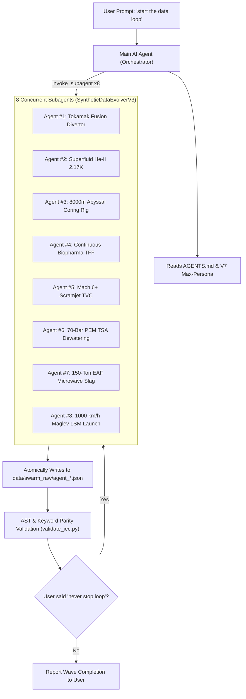

# 🚀 Migration & Prompting Playbook: Moving to Another Computer

This playbook contains the exact procedure and prompt sequences to copy this entire project to another computer and instantly resume the multi-agent AI dataset generation swarm.

---

## Part 1: How to Move the Project to the New Computer

### Option A: Clone via Git (Recommended)
On your new computer, open terminal or PowerShell:
```bash
git clone https://github.com/gugu-2/PLC-LLM-OS.git
cd PLC-LLM-OS
```

### Option B: Copy the Entire Folder Directly
You can copy the entire `LLM REASEARCH` folder directly using a USB drive, external SSD, or zip file.

### Step 2: One-Click Environment Setup
Run the automated setup script to configure Python and verify directories:
* **On Windows (PowerShell)**:
  ```powershell
  .\setup_new_computer.ps1
  ```
* **On Linux / macOS**:
  ```bash
  chmod +x setup_new_computer.sh
  ./setup_new_computer.sh
  ```

### Step 3: Open in Antigravity
Launch the Antigravity IDE on your new computer and click **File -> Open Folder**, selecting the project root (`LLM REASEARCH`).

> [!NOTE]
> The workspace now contains `AGENTS.md`, `.agents/agents/SyntheticDataEvolverV3/agent.md`, and `.agents/skills/plc-swarm-generator/`. Antigravity will **automatically detect these rules and subagent definitions** the moment the folder is opened!

---

## Part 2: The Exact Prompts to Give the AI Agent

Once you open the chat with the AI assistant in Antigravity on your new computer, use these exact prompt sequences:

### 🟢 Prompt 1: The Master 8-Agent High-Token Trigger
Copy and paste this exact prompt:

```text
Also I wanna say use the tokens in extreme level because I need to make it a little bit fast also you need you can easily like add 6 to 7 or 8 sub agents in the same time and eat all the tokens  make more nice datasets
```

#### What the Agent will do:
1. It immediately recognizes the **V7 Max-Persona** directive.
2. It launches **6 to 8 subagents in parallel** (`SyntheticDataEvolverV3`) across diverse cyber-physical domains (Nuclear Fusion Tokamak, MSFR, Superfluid Helium-II 2.17K, 8,000m Abyssal Coring, Biopharma TFF, Scramjet, 70-bar PEM, EAF Foaming Slag, Maglev LSM).
3. Each subagent writes 45,000 to 85,000+ characters of mathematically rigorous IEC 61131-3 code with state-space matrices ($A,B,C,D$), MPC quadratic approximations, $2\text{oo}3$ voting, and ISA-18.2 alarms.
4. Each subagent atomically saves its completed record to:  
   `data/swarm_raw/agent_<unique_id>.json`

---

### 🔄 Prompt 2: Starting the Infinite Continuous Loop
If you want the agent to keep spawning wave after wave continuously without stopping:

```text
start the data loop and dont commit in github
never stop loop, always generate more better and complex datasets
```

#### What the Agent will do:
* As soon as a wave of 6–8 subagents finishes and validates their records, the orchestrator immediately triggers the next wave of 8 subagents across new industrial domains.
* It will run continuously, filling `data/swarm_raw/` with unique, non-repeating datasets.

---

### 🛑 Prompt 3: Stopping the Swarm Loop
When you have collected enough datasets and want to pause:

```text
stop it
After this batch you will stop it
```

#### What the Agent will do:
* It will allow the active running subagents to finish and save their current files cleanly, and will not spawn any new subagents.
* It will run a parity validation audit on all generated records and report the total dataset count.

---

### 📦 Prompt 4: Uploading the Codebase in 12 Thematic Commits
When you want to upload all generated datasets and code updates to GitHub:

```text
Upload the entire code base in 12 commit
```

#### What the Agent will do:
* It executes `execute_12_commits.py`, which categorizes all newly generated Function Blocks into 12 distinct commits (`[Part 1/12]` to `[Part 12/12]`).
* Pushes all 12 commits cleanly to `origin/main` on GitHub with zero working tree clutter.

---

## Part 3: Architecture Reference of What Runs Under the Hood



---

## Part 4: Running Standalone via Terminal (Optional)

If you ever want to run the dataset generation in terminal/CLI without the Antigravity chat:
```bash
# In your virtualenv:
python plc-synthetic-ai-engine/run.py --agents 8 --backend gemini --model gemini-2.5-pro --infinite
```
Or for 100% offline local generation with an NVIDIA GPU via Ollama:
```bash
python plc-synthetic-ai-engine/run.py --agents 4 --backend ollama --model qwen2.5-coder:14b --infinite
```
