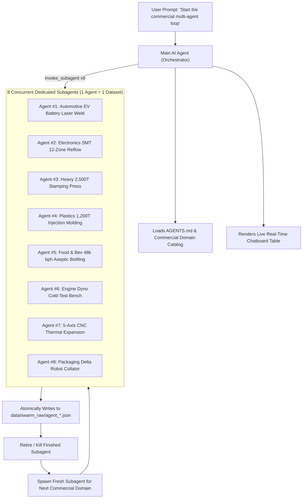

# 🚀 Migration & Prompting Playbook: Moving to Another Computer

This playbook contains the exact procedure and prompt sequences to copy this entire project to another computer and instantly resume the multi-agent AI dataset generation swarm.

---

## Part 1: How to Move the Project to the New Computer

### Option A: Clone via Git (Recommended)
On your new computer, open terminal or PowerShell:
```bash
git clone https://github.com/gugu-2/PLC-LLM-OS.git
cd PLC-LLM-OS
```

### Option B: Copy the Entire Folder Directly
You can copy the entire `LLM REASEARCH` folder directly using a USB drive, external SSD, or zip file.

### Step 2: One-Click Environment Setup
Run the automated setup script to configure Python and verify directories:
* **On Windows (PowerShell)**:
  ```powershell
  .\setup_new_computer.ps1
  ```
* **On Linux / macOS**:
  ```bash
  chmod +x setup_new_computer.sh
  ./setup_new_computer.sh
  ```

### Step 3: Open in Antigravity
Launch the Antigravity IDE on your new computer and click **File -> Open Folder**, selecting the project root (`LLM REASEARCH` or `PLC-LLM-OS`).

> [!NOTE]
> The workspace contains `AGENTS.md`, `.agents/agents/SyntheticDataEvolverV3/agent.md`, and `.agents/skills/plc-swarm-generator/`. Antigravity will **automatically detect these rules, subagent definitions, and commercial industry skills** the moment the folder is opened!

---

## Part 2: The Exact Prompts to Give the AI Agent on the New Computer

Once you open the chat with the AI assistant in Antigravity on your new computer, use these exact prompt sequences:

### 🟢 The Master Commercial Swarm Prompt (Copy & Paste This)

```text
Start the multi-agent dataset generation loop with 8 concurrent AI agents. Use tokens at an extreme level and eat all tokens to generate ultra-dense datasets.

Follow these strict rules:
1. FOCUS EXCLUSIVELY ON MULTI-BILLION-DOLLAR COMMERCIAL MANUFACTURING INDUSTRIES (Automotive EV battery pack laser welding & dispensing, Electronics SMT 12-zone reflow oven, Heavy mechanical 2500-ton servo press die cushion, Plastics 1200-ton injection molding V/P switchover, Food & Beverage 48000 bph aseptic bottling, Automotive engine assembly cold-test dyno, 5-axis CNC thermal tool wear compensation, High-speed delta robot cartoner packaging). No space or academic physics labs.
2. AGENT LIFECYCLE: One AI agent is dedicated to generating EXACTLY ONE dataset. Once it finishes and atomically saves its dataset, kill/retire that agent and immediately spawn a fresh new agent in its place.
3. LIVE CHATBOARD DISPLAY: Show a real-time markdown status table on the chatboard showing each active agent, assigned commercial system, status ([SPAWNED], [SYNTHESIZING], [VALIDATING], [SAVED]), character/token count, and total completed datasets.
4. CONTINUOUS LOOP: Never stop the loop, keep cycling and generating more complex, pristine IEC 61131-3 Structured Text datasets.
```

---

### 🔍 What the Agent Will Do When You Run This Prompt:
1. **Commercial Manufacturing Focus**: Rotates strictly across real-world commercial factory floors (Automotive, SMT Electronics, Heavy Stamping, Plastic Injection, Food/Bev Aseptic Bottling, Powertrain, CNC, Robotics).
2. **Dynamic 1-Agent = 1-Dataset Lifecycle**:
   - Spawns 8 concurrent `SyntheticDataEvolverV3` agents simultaneously.
   - Each agent synthesizes a massive 45,000 to 85,000+ character Function Block with state-space matrices ($A,B,C,D$), MPC quadratic cost functions, $2\text{oo}3$ voting, and ISA-18.2 alarms.
   - Each agent atomically writes its record to `data/swarm_raw/agent_<uuid>.json`.
   - Once validated, that agent is retired, and a brand-new subagent is spawned to tackle the next commercial domain.
3. **Real-Time Live Chatboard Display**:
   On every cycle, the orchestrator renders a live status table:

| Agent ID | Commercial Industrial Sector | Specific Automation System | Real-time Status | Dataset Chars | Completed |
| :---: | :--- | :--- | :---: | :---: | :---: |
| `Agent #01` | Automotive & EV | EV Battery Pack CTP Laser Busbar Welding | `[SAVED]` | 72,450 | 1 |
| `Agent #02` | Electronics SMT | SMT 12-Zone Convection Reflow Oven N2 | `[SYNTHESIZING]` | ~54,000 | 0 |
| `Agent #03` | Heavy Mechanical | 2,500-Ton Servo Stamping Press Die Cushion | `[VALIDATING]` | 68,120 | 0 |
| `Agent #04` | Plastics & Polymers | 1,200-Ton Injection Molding V/P Switchover | `[SAVED]` | 78,900 | 1 |
| `Agent #05` | Food & Beverage | 48,000 bph Rotary Aseptic Bottling & VHP | `[SYNTHESIZING]` | ~61,000 | 0 |
| `Agent #06` | Automotive Powertrain | Engine Assembly Cold-Test Dyno & Leakage | `[SPAWNED]` | 0 | 0 |
| `Agent #07` | Precision Machining | 5-Axis Gantry CNC Spindle Thermal Growth | `[SYNTHESIZING]` | ~49,000 | 0 |
| `Agent #08` | High-Speed Packaging | Multi-Lane Infeed 4-Axis Delta Robot | `[SAVED]` | 64,800 | 1 |

---

### 🛑 How to Stop the Loop
When you have collected enough datasets and want to pause:
```text
stop it
After this batch you will stop it
```
The agent will let the current active subagents finish and save their files, run a validation pass, and display the final dataset tally.

---

### 📦 How to Upload to GitHub in 12 Commits
When you want to push all generated datasets and code updates to GitHub:
```text
Upload the entire code base in 12 commit
```
The agent executes `execute_12_commits.py`, partitions new datasets into 12 thematic parts (`[Part 1/12]` to `[Part 12/12]`), and pushes cleanly to `origin/main`.

---

## Part 3: Architecture Reference of the Commercial Swarm



---

## Part 4: Running Standalone via Terminal (Optional)

If you ever want to run the dataset generation in terminal/CLI without the Antigravity chat:
```bash
# Using Cloud Gemini 2.5 Pro / Flash
python plc-synthetic-ai-engine/run.py --agents 8 --backend gemini --model gemini-2.5-pro --infinite

# Or 100% offline local generation with an NVIDIA GPU via Ollama
python plc-synthetic-ai-engine/run.py --agents 4 --backend ollama --model qwen2.5-coder:14b --infinite
```


---

## Part 5: Complete Conversation Archive & Engineering Changelog

The repository includes a complete historical record of all 306 conversation turns, user requests, architectural decisions, and code changes:
* **[00_Master_Chronology_and_Index.md](conversation/00_Master_Chronology_and_Index.md)**: Full master index of all 306 turns.
* **[09_Full_Project_Lifetime_Chat_History_and_Changelog.md](conversation/09_Full_Project_Lifetime_Chat_History_and_Changelog.md)**: Turn-by-turn detailed changelog describing exact file mutations, tools invoked, and engineering actions.
* **Thematic Logs (conversation/01 to conversation/08)**: Deep-dive archives categorized by Architecture, Scraping, Swarms, Validation, Training, Offline RTX 5050, and Git Maintenance.
