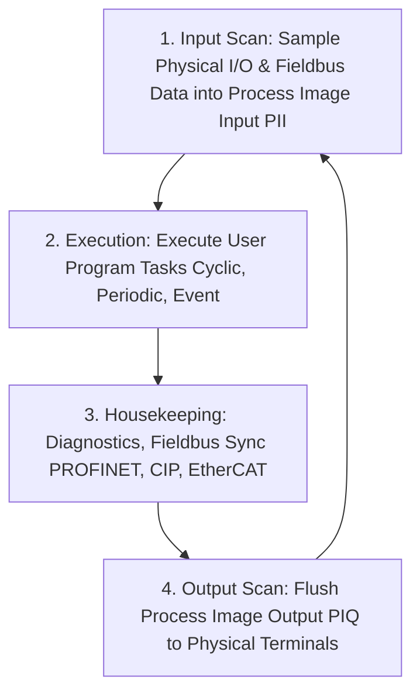

# PLC_DOMAIN_INTELLIGENCE.md — Industrial Domain Intelligence Specification

**Document Version**: 2.0.0  
**Classification**: Industrial Automation Engineering & Domain Intelligence Reference  
**System**: Industrial PLC Code Intelligence & Multi-Dialect Synthesis Platform  
**Author**: Principal Industrial Automation Fellow & AI Systems Architect  
**Date**: November 23, 2026  
**Status**: ACTIVE & LIVING DOMAIN INTELLIGENCE REFERENCE  

---

## 1. Manufacturing Engineering Foundations

Industrial automation engineering is fundamentally different from generic enterprise software engineering. It operates under physical constraints dictated by real-world physics, hard real-time execution bounds, and human/machine safety regulations.

### 1.1 The Deterministic Scan Cycle
Every Programmable Logic Controller (PLC) operates within an infinite, cyclic scan loop:

$$\text{Scan Cycle} = T_\text{Input Read} + T_\text{Program Logic Execution} + T_\text{Diagnostics \& Comm} + T_\text{Output Write}$$



- **Target Scan Times**:
  - High-speed motion & packaging: $1\text{ ms} - 5\text{ ms}$.
  - Machine tooling & assembly: $10\text{ ms} - 25\text{ ms}$.
  - Continuous process automation: $50\text{ ms} - 100\text{ ms}$.
- **Engineering Imperative**: Infinite loops (`WHILE TRUE DO`), blocking delays, or unbounded recursion cause an immediate **PLC Watchdog Fault**, tripping the main contactor and executing an emergency shutdown.

### 1.2 Memory Models: Process Image vs. Direct I/O
- **PII / PIQ (Process Image)**: Inputs are latched at the start of the scan; outputs are written at the end. Logic operations read from and write to internal memory tables to ensure signal stability throughout the scan.
- **Direct / Immediate I/O**: Direct memory peripheral access (`%IW...:P` in Siemens or immediate inputs in Rockwell). Used strictly for high-speed hardware interrupts, encoder strobes, or emergency interlocks.

---

## 2. Multi-Dialect Programming Environments (IEC 61131-3)

The platform natively supports all five IEC 61131-3 programming languages, with primary specialization in Structured Text and Ladder Diagram, augmented by Function Block Diagrams and Sequential Function Charts.

### 2.1 Structured Text (ST / SCL)
High-level, block-structured language ideal for complex mathematics, state-space matrix manipulation, Model Predictive Control (MPC), string parsing, and recipe management.
- **Syntax Rules**: Case-insensitive keywords, mandatory semicolon termination (`;`), assignment operator `:=`, equality operator `=`, type conversion functions (`INT_TO_REAL`, `REAL_TO_DINT`).
- **Control Structures**: `IF ... ELSIF ... ELSE ... END_IF;`, `CASE ... OF ... END_CASE;`, `FOR ... TO ... BY ... DO ... END_FOR;`, `WHILE ... DO ... END_WHILE;`, `REPEAT ... UNTIL ... END_REPEAT;`.

### 2.2 Ladder Diagram (LD / RLL)
Graphical language representing relay logic circuits, widely preferred on North American factory floors for discrete machine interlocks, motor start/stop sequences, and safety monitoring.
- **Core Elements**:
  - `XIC` (Examine If Closed / Normally Open Contact): `-[ ]-`
  - `XIO` (Examine If Open / Normally Closed Contact): `-[/]-`
  - `OTE` (Output Energize / Coil): `-( )-`
  - `OTL` / `OTU` (Output Latch / Unlatch): `-(L)-` / `-(U)-`
  - `TON` / `TOF` (Timer On/Off Delay): Blocks with `.EN`, `.TT`, `.DN` bits.
- **ASCII Representation Standard**:
  ```text
  Rung 0: [E_Stop_OK]----[/Fault_Active]----[Start_PB]----+----(Motor_Run)
                                                          |
                                                    [Motor_Aux]--+
  ```

### 2.3 Sequential Function Chart (SFC)
Graphical language for sequential and parallel machine mode sequencing (IEC 61131-3 Clause 4).
- **Architecture**: Alternating Steps (with initial step `INIT`) and Transitions evaluated every scan.
- **Step Actions**: Non-stored (`N`), Set (`S`), Reset (`R`), Time-delayed (`D`), Time-limited (`L`).
- **Parallel Branching**: Divergence (`===`) and Convergence (`===`) for simultaneous multi-axis or multi-station tooling.

### 2.4 Function Block Diagram (FBD)
Graphical signal-flow language ideal for continuous process control, PID loops, digital signal filters, and drive speed cascades.

---

## 3. Vendor Architectures & Dialect Specifics

The platform implements vendor-aware compilation engines rather than treating all PLCs as identical.

### 3.1 Siemens SIMATIC (TIA Portal / S7-1200 / S7-1500)
- **Language**: Structured Control Language (SCL), Ladder (LAD), Function Block Diagram (FBD), GRAPH.
- **Program Organization Units (POUs)**:
  - **Organization Blocks (OB)**: Interface between OS and user program. `OB1` (Main cyclic), `OB30`–`OB38` (Cyclic interrupts, e.g., 10ms PID), `OB82` (Diagnostic alarm), `OB100` (Startup initialization).
  - **Function Blocks (FB)**: POUs with static memory backed by an **Instance Data Block (IDB)**.
  - **Functions (FC)**: Stateless POUs returning values via temporary stack memory (`TEMP`).
  - **Data Blocks (DB)**: Global DBs (shared data), Instance DBs (FB state storage), Multi-instance DBs.
- **Data Types**: User Defined Types (UDTs), System Data Types (`IEC_TIMER`, `IEC_COUNTER`).
- **Optimized vs. Standard Block Access**:
  - *Optimized Access*: Memory offsets are hidden and automatically aligned by the CPU compiler for maximum performance and symbolic addressing.
  - *Standard Access*: Traditional byte/bit offset addressing (`DB1.DBX0.0`, `DB1.DBD4`), required for legacy communication and Snap7 S7 Comm drivers.
- **Export Formats**: `.scl` source files, SimaticML / TIA Portal Openness XML.

### 3.2 Rockwell Automation / Allen-Bradley (ControlLogix & CompactLogix)
- **Platform**: Studio 5000 Logix Designer / RSLogix 5000.
- **Language**: Structured Text (ST), Relay Ladder Logic (RLL), Function Block Diagram (FBD), Sequential Function Chart (SFC).
- **Memory Paradigm**: Pure Tag-Based Addressing (No DBs).
  - *Controller Tags*: Globally visible across the entire chassis.
  - *Program Tags*: Isolated scope within a specific program container.
- **Program Organization**:
  - Tasks (Continuous, Periodic, Event-driven) $\rightarrow$ Programs $\rightarrow$ Routines (ST, RLL, FBD).
- **Add-On Instructions (AOIs)**:
  - Encapsulated reusable logic with `InputParameters`, `OutputParameters`, `InOutParameters` (passed by reference, critical for large arrays and UDTs), and internal `LocalTags`.
- **Export Format**: Studio 5000 `.L5X` XML (native project import/export format).

### 3.3 Beckhoff Automation (TwinCAT 3)
- **Platform**: TwinCAT 3 (eXtended Automation Engineering / XAE, Visual Studio shell).
- **Runtime**: Real-time kernel running on Windows ring 0 alongside generic OS.
- **Language**: IEC 61131-3 3rd edition + Object-Oriented Programming (OOP) extensions:
  - `FUNCTION_BLOCK FB_Name EXTENDS FB_Base IMPLEMENTS I_DriveControl`
  - `METHOD`, `PROPERTY` (Get/Set), `INTERFACE`.
- **POU Extensions**: `.TcPOU` (XML wrapping ST logic), `.TcDUT` (Data Unit Types / structs / enums), `.TcGVL` (Global Variable Lists).
- **Fieldbus & Protocol**: Native EtherCAT master, ADS (Automation Device Specification) client/server message router.

### 3.4 CODESYS v3.5 & Schneider Electric
- **Platform**: CODESYS Development System, Schneider EcoStruxure Machine Expert.
- **Standard**: Complete implementation of IEC 61131-3 3rd Edition.
- **Variables**: Located memory (`%IX0.0`, `%QX0.0`, `%MW100`) and unlocated symbolic variables.

---

## 4. Manufacturing Application Archetypes

The AI platform specializes in high-volume, high-reliability commercial manufacturing environments:

### 4.1 Assembly Lines & Conveyor Collation
- **Systems**: Multi-zone roller conveyors, cross-belt sorters, pallet indexing shuttles.
- **Control Paradigms**: Jam detection timers, photo-eye debounce filters, variable frequency drive (VFD) acceleration/deceleration S-curves, bar-code tracking shift registers (FIFO queues).

### 4.2 Machine Sequencing & Mode Management (PackML / OMAC)
- **Standard**: ANSI/ISA-TR88.00.02 (PackML).
- **Core State Machine Model**:
  ```mermaid
  stateDiagram-v2
      [*] --> STOPPED
      STOPPED --> RESETTING : Reset Command
      RESETTING --> IDLE : State Complete
      IDLE --> STARTING : Start Command
      STARTING --> EXECUTE : State Complete
      EXECUTE --> HOLDING : Hold Command
      HOLDING --> HELD : State Complete
      HELD --> UNHOLDING : Unhold Command
      UNHOLDING --> EXECUTE : State Complete
      EXECUTE --> STOPPING : Stop Command
      EXECUTE --> ABORTING : Fault / E-Stop
      ABORTING --> ABORTED : State Complete
      ABORTED --> CLEARING : Clear Faults
      CLEARING --> STOPPED : State Complete
  ```
- **PackTags**: Standardized communication tags (`Command`, `Status`, `Admin`).

### 4.3 Batching & Recipe Management (ISA-88)
- **Standard**: ANSI/ISA-88 (S88).
- **Hierarchy**: Enterprise $\rightarrow$ Site $\rightarrow$ Area $\rightarrow$ Process Cell $\rightarrow$ Unit $\rightarrow$ Equipment Module (EM) $\rightarrow$ Control Module (CM).
- **Phases & Operations**: Dosing, mixing, heating, reacting, discharging phases with strict parameter setpoints and recipe verification.

### 4.4 High-Precision Motion Control & Robotics Integration
- **Systems**: Electronic camming (E-CAM), electronic gearing (E-Gear), flying shears, rotary knife cutoff, robot cell interlocks.
- **PLCopen Motion Control**: Standard Function Blocks: `MC_Power`, `MC_MoveAbsolute`, `MC_MoveVelocity`, `MC_CamIn`, `MC_GearIn`, `MC_Stop`.
- **Robotic Handshakes**: Digital safety zones, tooling permissive bits, zone clear signals, part present confirmation.

### 4.5 Alarm Management & Hysteresis (ISA-18.2)
- **Standard**: ANSI/ISA-18.2 Management of Alarm Systems for the Process Industries.
- **Tiers**: `HH` (Trip/E-Stop), `H` (Warning), `L` (Warning), `LL` (Trip/E-Stop).
- **Deadband Hysteresis**: Prevents alarm chattering around threshold boundaries:
  $$\text{Deactivation Limit} = \text{Trip Setpoint} \mp \text{Deadband}$$
- **Suppression & Shelving**: State-dependent alarm masking (e.g., suppressing low-pressure alarms during pump startup sequence).

---

## 5. Engineering Intelligence: Requirements Clarification Matrix

When an automation user or field engineer prompts the AI with incomplete specifications, the platform **never invents hardware addresses, voltages, or safety architectures**. It executes a structured engineering intake inquiry:

| Missing Parameter | Target Clarification Question | Fallback Engineering Default (Reported to User) |
|---|---|---|
| **Target PLC Vendor** | "Which target PLC hardware and engineering software are you targeting (e.g. Siemens S7-1500 / TIA Portal v18, Rockwell ControlLogix / Studio 5000 v34, Beckhoff TwinCAT 3, or CODESYS v3.5)?" | Generic IEC 61131-3 3rd Edition Structured Text |
| **I/O Memory Addressing** | "What are the specific physical I/O tag names or memory addresses for the sensors and actuators (or should symbolic UDT tags be created)?" | Generates structured Symbolic UDT Tag mapping (`ST_Inputs`, `ST_Outputs`) |
| **Operating Modes** | "Does the system require manual jogging, semi-automatic step, and automatic cycle modes per PackML or a custom state machine?" | Implements standard PackML 17-state finite state machine |
| **Motion Drive Type** | "Is the motor driven via direct digital contactors, analog 4-20mA VFD, or fieldbus cyclic motion (e.g. PROFINET IRT / EtherCAT CiA 402)?" | Standard digital Run/Fault handshake with 0-10V analog speed setpoint |
| **Safety Integration** | "Are the emergency stops and safety gates wired to a dedicated Safety PLC (e.g. GuardLogix / F-CPU) or standard hardwired safety relays?" | Standard software interlock permissive bit with explicit warning that hardware safety relays must govern physical power |
| **Scan Cycle Constraint** | "What is the target execution task period (e.g., 2ms for motion, 10ms for logic, or 50ms for process)?" | 10ms periodic task assumption |

This rigorous domain intelligence guarantees that generated code matches real factory hardware, complies with physical laws, and prevents catastrophic industrial incidents.
