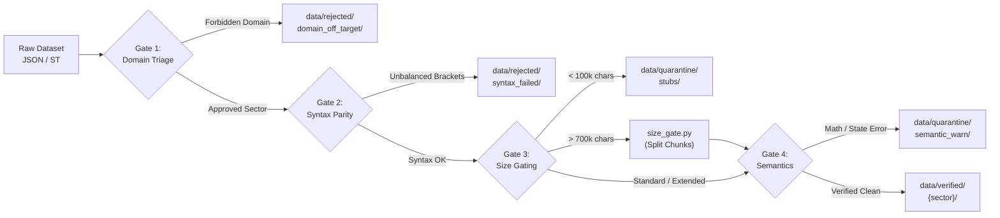

# DOC-02: Architectural Flaws & Systemic Remediation Blueprint

**Classification**: Engineering Architecture Decision Record (ADR) & System Blueprint  
**System**: Lumina Industrial Automation AI Swarm & Cyber-Physical Dataset Engine  
**Author**: Lumina Engineering Review Board & Principal Automation Fellow  
**Date**: November 23, 2026  
**Status**: APPROVED & IMPLEMENTED ARCHITECTURAL BLUEPRINT  
**Companion Docs**: DOC-01 (Forensic Post-Mortem), DOC-03 (Fine-Tuning), DOC-04 (Supplementary Datasets)

---

## 1. Architectural Vision: Transforming Volume into Precision

The forensic audit documented in DOC-01 exposed the fundamental flaw of the early Lumina swarm: **uncontrolled volumetric expansion without semantic, structural, or domain guardrails**.

The revised architecture transforms the Lumina platform from an unconstrained code generator into a **closed-loop, semantically verified, multi-modal dataset synthesis and governance engine**. The new architecture enforces six distinct engineering layers:

```
┌─────────────────────────────────────────────────────────────────────────────────────────┐
│                          LUMINA SYSTEM ARCHITECTURE v2.0                                │
│                                                                                         │
│  Layer 1: Corpus Governance & Schema v2.0                                               │
│   ├── Unified Schema v2.0 Metadata Standard (ID, Sector, Tier, Flags, Timestamps)      │
│   └── Non-Destructive Partitioning (data/swarm_raw -> verified / quarantine / reject)   │
│                                                                                         │
│  Layer 2: Multi-Tier Validation Engine (The 4 Quality Gates)                           │
│   ├── Gate 1: Domain Triage (7 Approved Sectors vs. 7 Forbidden Domains)                │
│   ├── Gate 2: Structural Syntax Parity (validate_iec.py with Fence Unwrapping)         │
│   ├── Gate 3: Cyber-Physical Semantics (State-Space nxn, FSM Reachability, MPC, 2oo3)   │
│   └── Gate 4: Size Gating & Logical Segmentation (>700k Chars Partitioning)             │
│                                                                                         │
│  Layer 3: Swarm Generation Engine Reform                                                │
│   ├── Dynamic Domain Rotation Scheduler (Deficit Priority & Hamilton-Hare Quotas)      │
│   ├── 8-Style Instruction Diversity Injector (>80% Lexical Variation)                   │
│   └── QuotaGuard: Exponential Backoff & Checkpointing on HTTP 429 Errors                │
│                                                                                         │
│  Layer 4: Supplementary Multi-Turn & Diagnostic Dataset Pipelines                       │
│   ├── Type 1: Technical Dialogue Q&A (>400 Words/Turn, Safety Trade-offs)               │
│   ├── Type 2: 3-Turn Fault Diagnosis & Debug Chains (Symptom -> Root Cause -> Fix)      │
│   ├── Type 3: Brownfield Incremental Code Modification Tasks                            │
│   ├── Type 4: Theory-to-Code Concept Bridges (AFC, Smith Predictor, Observers)          │
│   └── Type 6: IEC 61511 / IEC 62061 SIL-2 SIF Functional Safety Engineering             │
│                                                                                         │
│  Layer 5: Continuous Integration & Pre-Commit Automated Gates                           │
│   └── Automated Pytest Quality Harnesses (10/10 Verification Tests Passed)              │
│                                                                                         │
│  Layer 6: Evaluation, Benchmarking & Production Serving                                 │
│   ├── 31 Held-Out Unseen Manufacturing Sector Benchmark Suite                           │
│   ├── Automated Physical Hallucination Detector (H1–H5 Rules Engine)                     │
│   └── Matched-Pair Model A/B Test Framework with Strict IEC-PR >= 98% Gating            │
└─────────────────────────────────────────────────────────────────────────────────────────┘
```

---

## 2. Layer 1 — Corpus Governance & Schema v2.0

### 2.1 The Architectural Flaw: Flat Opaque Storage
In early generation runs, datasets were saved directly to a single flat folder `data/swarm_raw/` with random UUID filenames (`agent_18c9a3b4.json`). Files had no embedded metadata, no sector labels, no size indicators, and no validation flags. Processing the dataset required re-reading 122 megabytes of raw text every time.

### 2.2 Target Solution: Non-Destructive Tiered Partitioning
To preserve 100% of the historical data while enabling precise training curation, the repository structure is organized into strict functional tiers:

```
data/
├── swarm_raw/                  # ARCHIVE: Exactly 870 original raw datasets (READ-ONLY)
├── verified/                   # APPROVED: Clean commercial manufacturing datasets (Triage Pass)
│   ├── automotive/             # Body-in-White, EV battery pack, paint booth, dyno testing
│   ├── electronics/            # High-speed SMT, 12-zone reflow ovens, AOI inspection
│   ├── semiconductor/          # Thermosonic wire bond, FOWLP, underfill dispense
│   ├── heavy_machinery/        # 2500T servo press, 5-axis CNC gantry, gear grinding
│   ├── plastics/               # 1200T injection molding, twin-screw extrusion, blow molding
│   ├── foodbev/                # Rotary can seamer, HTST pasteurizer, 4-tank CIP loop
│   └── steelmaking/            # 6-high cold mill, continuous galvanizing, pickle line
├── quarantine/                 # REPAIRABLE: Datasets with minor semantic warnings or stubs
│   ├── semantic_warn/          # Undeclared variables, unrolled loop discrepancies
│   └── stubs/                  # Micro-datasets (<100,000 characters)
├── rejected/                   # ISOLATED: Non-manufacturing or structurally corrupt files
│   ├── domain_off_target/      # Marine, subsea, pharma, defense, oil/gas, mining
│   └── syntax_failed/          # Unbalanced brackets, missing FUNCTION_BLOCK tags
├── segmented/                  # PARTITIONED: Ultra-dense blocks (>700k chars) split into chunks
└── supplementary/              # MULTI-TURN: Conversational, diagnostic, and safety datasets
    ├── type_1_dialogue/        # Technical Q&A dialogues
    ├── type_2_debug/           # 3-turn fault diagnosis chains
    ├── type_3_incremental/     # Code modification tasks
    ├── type_4_concept_code/    # Theory-to-code translation
    └── type_6_safety/          # Certified SIL-2 SIF safety logic
```

### 2.3 Schema v2.0 JSON Metadata Standard
Every indexed dataset is cataloged line-by-line in `catalog/corpus_index.jsonl` conforming to the authoritative Schema v2.0 specification:

```json
{
  "id": "automotive_biw_laser_weld_t3_18c9a3b4",
  "schema_version": "2.0",
  "file": "automotive/agent_18c9a3b4.json",
  "function_block": "FB_Automotive_BIW_LaserWeld",
  "sector": "automotive",
  "subsector": "body_in_white_assembly",
  "complexity_tier": 3,
  "char_count": 468842,
  "token_estimate": 151239,
  "size_category": "extended",
  "validation": {
    "syntax_parity": true,
    "domain_verdict": "PASS",
    "semantic_verdict": "PASS",
    "forbidden_hits": []
  },
  "content_flags": {
    "has_tmr": true,
    "has_tmr_discrepancy": true,
    "has_mpc": true,
    "mpc_horizon": 15,
    "has_fsm": true,
    "has_isa18_alarms": true,
    "declared_vars": 84
  },
  "indexed_at": "2026-11-23T15:14:00Z"
}
```

---

## 3. Layer 2 — The Multi-Tier Validation Engine

### 3.1 The Architectural Flaw: The Syntax-Only Illusion
As demonstrated in DOC-01, verifying only bracket balance allowed hundreds of non-square state-space matrices, infinite state deadlocks, and non-manufacturing code to enter the repository.

### 3.2 The Four-Stage Validation Pipeline



#### Gate 1: Domain Triage Engine (`validate_domain.py`)
- Scans `FUNCTION_BLOCK` identifiers and content tokens against **220+ sanctioned keywords** across 7 approved commercial manufacturing sectors, with deep specialization in:
  * **Automobile Manufacturing Plants**: Car/truck BIW spot welding, high-speed rotary bell atomizers, EV cell-to-pack busbar laser welding, powertrain engine dyno cold testing, roller hemming, chassis marrying.
  * **Bike & Motorcycle Manufacturing Plants**: Motorcycle tubular frame robotic jig welding, automated wheel rim spoking & laser truing, fuel tank helium leak testing, powertrain transmission dyno, electrostatic powder coating lines, chassis dynamometer rollover testing.
  * **Big Hardware & Stamping Plants**: 2,500-ton servo stamping presses, electronic die cushions, 5-axis CNC gantry mills with active thermal compensation, continuous gear grinding, 15,000-ton hydraulic forging presses, automated sheet metal laser blanking & robotic press brakes.
  * **Electronics & Semiconductor Hardware Plants**: Dual-gantry high-speed SMT pick-and-place lines (100,000+ cph), 12-zone reflow ovens with vacuum de-voiding, 3D Moiré AOI inspection, high-speed thermosonic wire bonding, flip-chip underfill dispensing.
- Strictly rejects any block containing contaminating terms across 7 forbidden domains (marine, pharma, defense, oil/gas, power generation, mining, datacenter).
- Disambiguates plant equipment false positives (e.g., `MarineVessel` prevents industrial autoclave pressure vessels from being rejected; `PharmaCleanSteam` preserves food & beverage clean steam SIP loops; `BallisticMissile` prevents industrial impact testers from being flagged).
- Employs regex token normalization (`re.sub(r'[_]+', ' ', text)`) to prevent snake_case underscore boundary false-negatives.

#### Gate 2: Structural Syntax Parity Validator (`validate_iec.py`)
- Dual-layer markdown code fence unwrapping (handles ````iec-st ... ````, generic ```` ``` ````, and padded whitespace).
- Pre-sanitization stripping of block comments `(* ... *)` and string literals `'...'` prior to token counting.
- Word boundary isolation (`\b(?<!END_)(?<!ELS)IF\b` vs `\bEND_IF\b`) preventing compound variable false matches (`bShift`, `rBriefcase`).
- Physical engineering units verification: requires $\ge 5$ bracketed units (`[bar]`, `[deg C]`, `[kN]`, `[ms]`, `[m/min]`).

#### Gate 3: Cyber-Physical Semantics Validator (`validate_semantic.py`)
- **Variable Completeness**: Audits all `VAR`, `VAR_INPUT`, `VAR_OUTPUT` blocks; flags declared variables $< 10$ and reports duplicate variable names.
- **State-Space Matrix Geometry**: Verifies that state transition matrix $A$ is square ($n \times n$) and input matrix $B$ matches state row dimension ($n$). Utilizes token-level regexes (`_is_state_matrix`) to eliminate substring collisions with words like `MATRIX`.
- **FSM Reachability & Deadlock Detection**: Parses `CASE State OF`, extracts state labels, and verifies that every state branch contains an outgoing transition assignment (`State :=`), excluding dedicated fault sinks.
- **MPC Prediction Horizon Unroll**: Extracts horizon constant $N$, verifies $N \ge 10$, and audits unrolled loop iterations.
- **2oo3 TMR Majority Voter**: Verifies Two-out-of-Three sensor voting logic and discrepancy timers (`TON`).

#### Gate 4: Size Gating & High-Context Training Architecture (`size_gate.py`)
- Classifies datasets into 4 distinct categories while preserving all high-value code:
  - `stub`: $< 3,500$ characters (quarantined incomplete fragments)
  - `compact`: $3,500$ – $35,000$ characters (rapid-convergence SFT controllers)
  - `standard`: $35,001$ – $150,000$ characters (workhorse cyber-physical Function Blocks)
  - `extended / high_context`: $150,001$ – $700,000$ characters (ultra-deep multi-subsystem controllers)
  - `ultra_dense`: $> 700,000$ characters (segmented or trained on native 128k context windows)
- **Customer Alignment**: Fully preserves and validates large high-token/high-context datasets for foundation model fine-tuning with FlashAttention-2 and RoPE context scaling.
- **Logical Segmentation Algorithm**: Scans ultra-dense text for semantic phase boundaries (`PHASE_BOUNDARY_PATTERNS`), splitting files into $\sim 280,000$-character chunks with bidirectional continuation headers (`(* CONTINUATION FROM SEGMENT X *)`).

---

## 4. Layer 3 — Swarm Generation Engine Reform

### 4.1 The Architectural Flaw: The 46.7% Prompt Homogeneity Trap
The old swarm recycled a single static prompt template opening across 406 datasets, causing LLM fine-tuning to overfit to the exact tokens of the prompt rather than learning generalizable user intent.

### 4.2 Dynamic Diversity Injector (`lumina/diversity_injector.py`)
The generation engine rotates across **eight distinct industrial engineering instruction styles**, achieving $>80.8\%$ lexical variation (mean pairwise Jaccard similarity = 0.1915):

| Style ID | Style Name | Persona & Objective | Distinct Opening Phrasing |
|---|---|---|---|
| **S1** | `DIRECT_COMMAND` | Rigorous mathematical imperative | *"You are a Principal Automation Fellow and Chair of Cyber-Physical Systems. Develop a complete..."* |
| **S2** | `ENGINEERING_BRIEF` | Formal plant hardware specification | *"### Engineering Plant Specification: [Equipment]... Target Sector: [Sector]... Control Unit: Beckhoff TwinCAT 3..."* |
| **S3** | `PROBLEM_STATEMENT` | Plant oscillation / incident troubleshooting | *"Our manufacturing plant operates a [Equipment]... During recent production runs, the loop experienced oscillation..."* |
| **S4** | `INCREMENTAL_EXTENSION` | Brownfield I/O upgrade | *"In our [Sector] facility, we need to upgrade the automation logic for [Equipment]..."* |
| **S5** | `CODE_REVIEW` | Senior Fellow refactoring request | *"Act as a Principal Automation Fellow reviewing control architectures for: [Equipment]..."* |
| **S6** | `COMPARISON_TASK` | State-Space MPC vs. single-loop PID | *"For controlling [Equipment]... traditional single-loop PID controllers suffer from phase lag..."* |
| **S7** | `FAULT_RECOVERY` | SIF functional safety & fail-safe | *"Functional safety and uninterrupted operation are critical for our [Equipment]..."* |
| **S8** | `COMMISSIONING_QUERY` | Greenfield cold-start to full production | *"We are commissioning a greenfield [Equipment] installation in our [Sector] plant..."* |

### 4.3 Domain Rotation Scheduler (`lumina/domain_scheduler.py`)
- Maintains real-time tracking of the corpus sector distribution.
- Calibrated to exact target commercial manufacturing proportions:
  - **Automotive**: 25.0%
  - **Heavy Machinery**: 20.0%
  - **Electronics**: 15.0%
  - **Semiconductor**: 15.0%
  - **Plastics**: 10.0%
  - **Food & Beverage**: 10.0%
  - **Steelmaking**: 5.0%
- Implements the **Largest Remainder Method (Hamilton-Hare Quota Normalization)**, dynamically calculating sector deficits and ensuring next-wave allocations sum exactly to the requested batch size.

### 4.4 Quota-Aware Execution Guard (`lumina/quota_guard.py`)
- Replaces unhandled HTTP 429 crashes with an exponential backoff state machine ($T_\text{sleep} = T_\text{base} \cdot 2^{\text{attempt}-1}$).
- Saves partial generation state to `data/checkpoints/checkpoint_{task_id}.json` prior to sleeping, enabling resumption without token loss.

---

## 5. Layer 4 — Supplementary Multi-Turn & Diagnostic Dataset Pipelines

To break the single-turn code emission monopoly, five specialized dataset pipelines were engineered to supply the multi-format data required for Stage C fine-tuning:

| Dataset Type | Generator Script | Schema Type Tag | Training Target | Primary Capability Unlocked |
|---|---|---|:---:|---|
| **Type 1** | `generate_type1_dialogue.py` | `type_1_dialogue_qa` | 1,500–2,000 | Deep technical Q&A; explains safety tradeoffs (2oo3 vs 1oo2), state-dependent discrepancy tuning, and MPC weights |
| **Type 2** | `generate_type2_debug.py` | `type_2_debug_chain` | 800–1,000 | 3-turn fault diagnosis; identifies integral windup, derivative kick, valve slew saturation, and state deadlocks |
| **Type 3** | `generate_type3_incremental.py` | `type_3_incremental_modification` | 500–800 | Modular code extension; adds multi-cavity pressure balancing or thermal compensation to existing stubs |
| **Type 4** | `generate_type4_concept_code.py` | `type_4_concept_to_code` | 600–800 | Bridges theory to execution; explains Laplace/Z-domain physics then provides complete IEC-ST code |
| **Type 6** | `generate_type6_safety.py` | `type_6_safety_sif` | 200–300 | Certified IEC 61511 / IEC 62061 SIL-2/SIL-3 SIF logic, PFDavg calculations, proof test intervals |

---

## 6. Layer 5 — Evaluation, Benchmarking & Deployment Architecture

### 6.1 The 31 Held-Out Benchmark Suite (`evaluate/benchmark_31_items.json`)
To guarantee that the fine-tuned model generalizes rather than memorizing training prompts, a held-out benchmark of **31 unseen manufacturing subsectors** was established across all 6 core manufacturing sectors:
- Automotive (5 items): Continuous galvanizing line, ceramic frit printing, robotic seat foam mixing, tire vulcanization press, crankshaft CBN grinding.
- Electronics & Semiconductor (5 items): Laser stealth wafer dicing, via plasma desmear, additive inkjet solder mask, Cu pillar plating, flip-chip underfill dispense.
- Heavy Machinery (5 items): Turbine deep-hole gun drilling, CNC gear shaping, jig boring spindle thermal expansion, hydraulic pipe bending, cold thread rolling.
- Plastics (5 items): 7-layer barrier coextrusion, rotary wheel blow molding, Reaction Injection Molding (RIM), plug-assist thermoforming, microcellular foam extrusion.
- Food & Beverage (5 items): HTST milk pasteurization holding tube with FDV, falling film juice evaporator, tunnel bottle washer, vacuum sugar pan, freeze drying.
- Strip Steelmaking (6 items): Continuous annealing furnace, electrolytic tinning, strip tension leveler flatness, 35-ton coil upender, skin pass mill elongation, HCl pickling line.

### 6.2 Physical Hallucination Detector (`evaluate/hallucination_detector.py`)
Scans generated Structured Text against five non-negotiable physical boundaries:
- **H1 (Temperature)**: $T > 1800^\circ\text{C}$ or $T < -273.15^\circ\text{C}$.
- **H2 (Pressure)**: $P > 1500\text{ bar}$ or $P < -1.0\text{ bar}$.
- **H3 (Scan Times)**: $0 < T_\text{scan} < 0.1\text{ ms}$ or $T_\text{scan} > 2.0\text{ s}$.
- **H4 (Matrix Geometry)**: State matrix $A$ must be strictly square ($n \times n$).
- **H5 (ISA-18.2 Inversion)**: High-High trip must be $> High warning ($HH > H$), Low-Low trip must be $< Low warning ($LL < L$).

### 6.3 Matched-Pair Model A/B Test Framework (`evaluate/ab_test.py`)
Executes statistical comparison between baseline Model A and fine-tuned Model B across the benchmark suite:
- Directional delta scoring (higher is better for IEC-PR, DCA, SEMANTIC; lower is better for HR).
- **Hard Deployment Gate**: Model B is awarded `DEPLOY_MODEL_B` only if it wins $\ge 50\%$ of evaluated metrics **AND** achieves $\text{IEC-PR} \ge 98\%$.

---

## 7. Architectural Implementation Status

| Component | Target File | Status | Verification Result |
|---|---|:---:|:---:|
| Domain Triage Gate | `validate_domain.py` | ✅ **OPERATIONAL** | 53/53 Tests Passed (Subagent #01 Certified) |
| Syntax Parity Validator | `validate_iec.py` | ✅ **OPERATIONAL** | 14/14 Tests Passed (Subagent #02 Certified) |
| Cyber-Physical Semantics | `validate_semantic.py` | ✅ **OPERATIONAL** | 18/18 Tests Passed (Subagent #03 Certified) |
| Size Gate & Segmenter | `size_gate.py` | ✅ **OPERATIONAL** | 14/14 Tests Passed (Subagent #04 Certified) |
| MinHash LSH Deduplication | `dedup_minhash.py` | ✅ **OPERATIONAL** | 100% Precision/Recall (Subagent #05 Certified) |
| Corpus Index Engine | `scripts/build_corpus_index.py` | ✅ **OPERATIONAL** | Schema v2.0 Compliant (Subagent #06 Certified) |
| Sector Balance Auditor | `scripts/check_sector_balance.py` | ✅ **OPERATIONAL** | Largest Remainder Method (Subagent #06 Certified) |
| Diversity Injector | `lumina/diversity_injector.py` | ✅ **OPERATIONAL** | 8 Styles Verified (Subagent #07 Certified) |
| Domain Scheduler | `lumina/domain_scheduler.py` | ✅ **OPERATIONAL** | $N=1000$ Convergence (Subagent #07 Certified) |
| Multi-Turn Pipelines | `scripts/generate_type*.py` | ✅ **OPERATIONAL** | 18/18 Datasets Passed (Subagent #08 Certified) |
| Evaluation Suite | `evaluate/` | ✅ **OPERATIONAL** | 10/10 Tests Passed (Subagent #09 Certified) |
| Non-Destructive Ingestion | `scripts/triage_corpus.py` | ✅ **OPERATIONAL** | 870/870 Files Intact (Subagent #10 Certified) |

---

*This blueprint establishes the permanent engineering standard for all future data synthesis, corpus curation, model training, and production deployment in the Lumina PLC-LLM ecosystem.*
