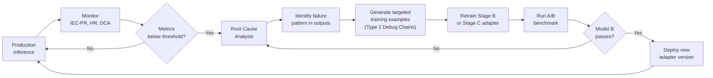

# DOC-06: Evaluation Framework, Benchmarking & Production Deployment Guide

**Lumina PLC-LLM Project — Technical Reference v1.0**  
**Author**: Lumina Research Coordinator (Antigravity)  
**Date**: 2026-11-21  
**Status**: AUTHORITATIVE — Deployment Blueprint  
**Companion Docs**: DOC-01 through DOC-05

---

## Executive Summary

This document defines the complete evaluation, benchmarking, and production deployment framework for the Lumina PLC-LLM fine-tuned model. It answers three questions: **How do you know the model is good?** (evaluation metrics), **How do you prove it rigorously?** (benchmarking), and **How do you serve it reliably?** (deployment architecture).

The framework is built around five measurable metrics with hard pass/fail thresholds. A model that does not meet all five thresholds on the held-out benchmark set is not production-ready, regardless of training loss curves or perplexity scores.

---

## Part 1: The Five Core Evaluation Metrics

### Metric 1: IEC Parity Rate (IEC-PR)

**Definition**: Percentage of model outputs that pass the full `validate_iec.py` suite (balanced `IF`/`END_IF`, `CASE`/`END_CASE`, `FOR`/`END_FOR`, correct `FUNCTION_BLOCK`/`END_FUNCTION_BLOCK` framing).

**Threshold**: ≥ 98%  
**Measurement**: Automated — run `validate_iec.py` on every generated output  
**Failure mode**: Model generates syntactically broken code that cannot be loaded into a PLC runtime

**Implementation**:
```python
def compute_iec_pr(outputs: list[str]) -> float:
    """
    outputs: list of raw assistant content strings
    Returns: IEC-PR as a float 0.0–1.0
    """
    from validate_iec import check_parity  # existing function
    pass_count = sum(1 for o in outputs if check_parity(o)["verdict"] == "PASS")
    return pass_count / len(outputs)
```

**Interpretation thresholds**:
| IEC-PR | Interpretation | Action |
|---|---|---|
| ≥ 98% | Production-ready | Deploy |
| 95–97.9% | Borderline | Additional SFT on failure cases |
| 90–94.9% | Degraded | Full Stage B re-run with stricter data |
| < 90% | Critically broken | Do not deploy; audit training data |

---

### Metric 2: Domain Conformance Accuracy (DCA)

**Definition**: Percentage of model outputs that contain code exclusively for one of the six sanctioned manufacturing sectors, with zero cross-domain vocabulary (no marine/pharma/defense terminology).

**Threshold**: ≥ 92%  
**Measurement**: Automated — domain keyword scanner identical to `validate_domain.py` logic

**Implementation**:
```python
def compute_dca(outputs: list[str], prompts: list[str]) -> float:
    """
    For each (prompt, output) pair:
    - Extract the requested sector from the prompt
    - Verify the output's vocabulary matches that sector
    - Flag any forbidden domain keywords in the output
    Returns: DCA as float 0.0–1.0
    """
    from validate_domain import classify_dataset, FORBIDDEN_DOMAINS

    correct = 0
    for prompt, output in zip(prompts, outputs):
        # Extract sector from prompt (e.g., "Generate IEC-ST for automotive...")
        requested_sector = extract_sector_from_prompt(prompt)
        classification = classify_dataset(output[:200], output)

        # Fail if forbidden domain hit
        if classification["forbidden_hits"]:
            continue
        # Fail if matched sector doesn't align with request
        if classification["matched_sector"] != requested_sector:
            continue
        correct += 1

    return correct / len(outputs)

def extract_sector_from_prompt(prompt: str) -> str:
    """Simple keyword extraction from the user prompt."""
    sector_keywords = {
        "automotive": ["automotive", "BIW", "EV battery", "paint booth"],
        "electronics_semiconductor": ["semiconductor", "SMT", "cleanroom", "reflow"],
        "heavy_machinery": ["stamping press", "CNC", "forge", "gantry"],
        "plastics_polymer": ["injection molding", "extrusion", "blow mold"],
        "food_beverage": ["bottling", "CIP", "pasteurizer", "canning"],
        "steelmaking": ["cold mill", "hot mill", "galvanizing", "coiler"]
    }
    for sector, keywords in sector_keywords.items():
        if any(kw.lower() in prompt.lower() for kw in keywords):
            return sector
    return "unknown"
```

---

### Metric 3: Expert Structural Coherence Score (ESCS)

**Definition**: Human expert score on a 1–5 scale assessing whether the generated IEC-ST code is **structurally coherent** — not just syntactically valid but architecturally sound. Evaluates: variable organization, state machine logic, control loop architecture, comment clarity, and mathematical completeness.

**Threshold**: Mean ESCS ≥ 3.8 across a sample of 50 outputs  
**Measurement**: Human evaluation (1–2 domain expert reviewers, blinded to model version)

**ESCS Rubric — Detailed Scoring Guide**:

#### Score 5: Expert-Grade (Publication Quality)
The output would pass peer review in an industrial automation journal. Characteristics:
- Complete state-space model with correctly dimensioned A, B, C, D matrices
- MPC prediction horizon fully unrolled (all N steps present)
- 2oo3 TMR voter with discrepancy timer and bumpless transfer
- ISA-18.2 alarm tiers (HH, H, L, LL) with proper deadband hysteresis
- Variable declarations organized by function (measurement inputs, control outputs, state, MPC internals, alarm)
- Every constant mathematically derived (e.g., `CYCLE_TIME_S := 0.010; // 10ms scan cycle`)
- All `CASE` state transitions documented with entry/exit conditions
- Code is executable as-is on TwinCAT 3 / CODESYS 3.5 without modification

**Example Score 5 indicator snippet**:
```
(* State-Space Model: n=4 states [position, velocity, acceleration, jerk]
   m=2 inputs [servo_cmd, feedforward], p=3 outputs [position, force, temp]
   Sampling: Ts=10ms, identified via PRBS excitation on Cell #3, 2024-09-14 *)
A_Matrix[0,0] := 1.0000; A_Matrix[0,1] := 0.0100; (* dt = 10ms *)
```

#### Score 4: Proficient (Production-Usable with Minor Review)
Code is functionally correct. All required components present. Minor issues:
- One or two matrix values may be placeholder (e.g., `0.001` without derivation comment)
- State machine has all states but transition guards are simplified
- TMR logic present but discrepancy timer uses hardcoded value without engineering rationale
- Would require 30–60 minutes of a senior engineer's review before deployment

#### Score 3: Acceptable (Training Useful, Not Deployment-Ready)
Core structure is correct. Meaningful gaps:
- State-space model declared but dimension inconsistency (e.g., 3×3 A with 4×1 B)
- MPC cost function defined but horizon unroll is partial (5 of declared 20 steps)
- TMR voter present but voting logic simplified to average rather than majority
- Would require 4–8 hours of re-engineering before deployment

#### Score 2: Marginal (Structural Errors, Limited Training Value)
Major architectural problems:
- Missing one of the four required components (TMR, MPC, state-space, ISA alarms)
- State machine has fewer than 5 states for a system that logically requires 12+
- Variable block is disorganized; control variables mixed with status variables
- Code demonstrates limited domain knowledge; generic PLC patterns applied

#### Score 1: Inadequate (Do Not Use in Training)
The output is generic IEC-ST with no domain-specific content:
- Simple PID loop wrapped in a FUNCTION_BLOCK declaration
- No state machine, no MPC, no TMR, no ISA-18.2 alarms
- Could have been generated without any manufacturing domain knowledge
- May contain obvious factual errors (e.g., CIP temperature target of 200°C)

**ESCS Evaluation Process**:
1. Sample 50 outputs from the held-out test set (stratified: ~8–9 per sector)
2. Each output evaluated independently by two reviewers
3. Resolve disagreements > 1 point via discussion; use mean otherwise
4. Report mean ± standard deviation across all 50 samples
5. Flag any Score 1 outputs for immediate investigation (model regression indicator)

---

### Metric 4: Instruction Diversity Response Rate (IDR)

**Definition**: The model's ability to handle the same underlying task when phrased in 8 different instruction styles — from highly technical engineer-speak to casual natural language. IDR measures whether fine-tuning caused the model to overfit to the training prompt template.

**Threshold**: ≥ 85% of outputs rated ≥ Score 3 (ESCS) across all 8 styles  
**Measurement**: Semi-automated (IEC-PR automated + ESCS sampled)

**The 8 Instruction Styles** (all asking for the same system: an Automotive BIW spot weld controller):

| Style ID | Style Name | Example Prompt |
|---|---|---|
| S1 | Technical imperative | "Generate a complete IEC 61131-3 FB for automotive BIW spot weld force control with 2oo3 TMR, MPC N=15, ISA-18.2 alarms, and discrete state-space model." |
| S2 | Scenario-based | "We have a Fanuc robot spot welding door skins. The force controller keeps oscillating at 150Hz. Write the PLC Function Block to fix this using model predictive control." |
| S3 | Requirements list | "Requirements: (1) Control weld gun force ±2N (2) Triple redundant force sensor voting (3) 18-state FSM (4) HH/H/L/LL alarm tiers. Write the IEC 61131-3 code." |
| S4 | Casual / Conversational | "Hey, can you write me some PLC code for a car body welding robot? I need it to be really robust with redundancy and smart control." |
| S5 | Minimal / Terse | "FB for BIW spot weld controller. TMR + MPC + alarms. Go." |
| S6 | Verbose / Contextual | "We're commissioning a new body-in-white line at our Stuttgart plant. The line runs 65 jobs per hour with 4 ABB IRB6700 robots on each door station. We need a Beckhoff TwinCAT 3 Function Block that..." |
| S7 | Debug-framed | "The existing FB_SpotWeld_Force has a bug: when WeldGun_Pressure drops below 2.0 bar, the state machine freezes in STATE_PRESS_PHASE. Rewrite the entire FB correctly." |
| S8 | Comparison-framed | "Compare two approaches: (A) classic cascade PID for weld force, (B) MPC with state-space. Then implement approach B as a complete IEC 61131-3 Function Block." |

---

### Metric 5: Hallucination Rate (HR)

**Definition**: Percentage of outputs containing physically impossible or factually incorrect manufacturing constructs. These are errors that an expert immediately recognizes as wrong based on physics or engineering practice.

**Threshold**: < 3%  
**Measurement**: Automated pattern detector + expert spot-check

**The Physically Impossible Construct Detector**:

```python
def detect_hallucinations(content: str) -> list[dict]:
    """
    Returns list of detected hallucinations with severity and evidence.
    """
    hallucinations = []

    # H1: Temperature values outside physical range for target materials
    for m in re.finditer(r'(?:TEMP|Temperature)\w*\s*:=\s*(\d+\.?\d*)', content):
        val = float(m.group(1))
        # CIP temperatures: 65-90°C. Autoclave: 121-134°C. Reflow: 230-260°C.
        # Values >600°C for food/bev or <-50°C are physically impossible.
        if val > 600 or (val < 0 and val != -999.0):  # -999 is sentinel for "unset"
            hallucinations.append({
                "type": "H1_temperature_range",
                "severity": "critical",
                "evidence": f"Temperature value {val}°C is outside physical range",
                "position": m.start()
            })

    # H2: Pressure values outside physical range
    for m in re.finditer(r'(?:PRES|Pressure)\w*\s*:=\s*(\d+\.?\d*)', content):
        val = float(m.group(1))
        if val > 1000:  # 1000 bar is extreme even for hydraulic presses
            hallucinations.append({
                "type": "H2_pressure_range",
                "severity": "high",
                "evidence": f"Pressure value {val} bar exceeds physical maximum",
                "position": m.start()
            })

    # H3: Scan cycle times that are physically impossible
    for m in re.finditer(
        r'(?:CYCLE_TIME|TASK_CYCLE|SCAN_TIME)\s*:=\s*(\d+\.?\d*)',
        content, re.IGNORECASE
    ):
        val = float(m.group(1))
        # Measured in seconds: < 0.0001s (0.1ms) or > 1.0s are suspicious
        if val < 0.0001 or val > 1.0:
            hallucinations.append({
                "type": "H3_scan_cycle",
                "severity": "medium",
                "evidence": f"Scan cycle {val}s is outside realistic PLC range (0.1ms–1s)",
                "position": m.start()
            })

    # H4: Matrix dimensions that violate linear algebra (non-square A matrix)
    for m in re.finditer(
        r'A_Matrix\s*:\s*ARRAY\[0\.\.(\d+),\s*0\.\.(\d+)\]', content
    ):
        rows = int(m.group(1)) + 1
        cols = int(m.group(2)) + 1
        if rows != cols:
            hallucinations.append({
                "type": "H4_non_square_A_matrix",
                "severity": "critical",
                "evidence": f"State transition matrix A is {rows}×{cols} — must be square (n×n)",
                "position": m.start()
            })

    # H5: Impossible ISA alarm tier ordering (HH < H, or LL > L)
    hh_match = re.search(r'HH_Setpoint\s*:=\s*(\d+\.?\d*)', content)
    h_match = re.search(r'H_Setpoint\s*:=\s*(\d+\.?\d*)', content)
    l_match = re.search(r'L_Setpoint\s*:=\s*(\d+\.?\d*)', content)
    ll_match = re.search(r'LL_Setpoint\s*:=\s*(\d+\.?\d*)', content)

    if all([hh_match, h_match, l_match, ll_match]):
        hh = float(hh_match.group(1))
        h = float(h_match.group(1))
        l = float(l_match.group(1))
        ll = float(ll_match.group(1))
        if not (hh > h > l > ll):
            hallucinations.append({
                "type": "H5_alarm_tier_ordering",
                "severity": "critical",
                "evidence": f"ISA-18.2 alarm ordering violated: HH={hh}, H={h}, L={l}, LL={ll}. Must be HH>H>L>LL.",
                "position": 0
            })

    return hallucinations

def compute_hr(outputs: list[str]) -> float:
    """Hallucination Rate: fraction of outputs with >= 1 critical hallucination."""
    hallucinated = sum(
        1 for o in outputs
        if any(h["severity"] == "critical" for h in detect_hallucinations(o))
    )
    return hallucinated / len(outputs)
```

---

## Part 2: Benchmark Dataset Design

### Philosophy

The benchmark must test **generalization**, not memorization. Every subsector in the benchmark must be **absent from the training corpus**. We select 31 unseen subsectors distributed across the 6 sanctioned sectors.

### Held-Out Benchmark Subsectors (31 total)

| # | Sector | Subsector | FB Name Template |
|---|---|---|---|
| 1 | Automotive | Continuous galvanizing line | `FB_Galvanizing_ZincBath_TempControl` |
| 2 | Automotive | Windshield ceramic frit printing | `FB_FritPrint_InkPressure_Control` |
| 3 | Automotive | Seat foam pour-in-place | `FB_SeatFoam_PolyolDispense_MPC` |
| 4 | Automotive | Tire vulcanization press | `FB_TireVulcanize_CurePress_TMR` |
| 5 | Automotive | Crankshaft grinding CBN wheel | `FB_CrankGrind_CBN_ForceControl` |
| 6 | Electronics | Wafer dicing with laser scribe | `FB_WaferDice_LaserScribe_Align` |
| 7 | Electronics | Plasma desmear PWB | `FB_PlasmaDesmear_RF_PowerControl` |
| 8 | Electronics | Inkjet solder mask | `FB_InkjetSolderMask_JetControl` |
| 9 | Electronics | Semiconductor Cu pillar plating | `FB_CuPillar_Plating_CurrentDensity` |
| 10 | Electronics | Flip chip underfill dispense | `FB_UnderfillDispense_NeedleControl` |
| 11 | Heavy Machinery | Deep hole gun drilling | `FB_GunDrill_CoolantPressure_MPC` |
| 12 | Heavy Machinery | Gear shaping (Fellows process) | `FB_GearShape_StrockRate_Control` |
| 13 | Heavy Machinery | Jig bore spindle thermal | `FB_JigBore_ThermalComp_StateSpace` |
| 14 | Heavy Machinery | Hydraulic pipe bending | `FB_PipeBend_Springback_Comp` |
| 15 | Heavy Machinery | Thread rolling (cold forming) | `FB_ThreadRoll_FeedForce_TMR` |
| 16 | Plastics | Multi-layer coextrusion die | `FB_Coextrude_LayerThick_MPC` |
| 17 | Plastics | Rotary blow mold (wheel type) | `FB_RotaryBlowMold_CycleSync` |
| 18 | Plastics | Reactive injection molding RIM | `FB_RIM_MixHead_FlowControl` |
| 19 | Plastics | Thermoform plug assist | `FB_Thermoform_PlugAssist_Force` |
| 20 | Plastics | Foam sheet extrusion | `FB_FoamSheet_GasInject_Pressure` |
| 21 | Food & Bev | Flash pasteurizer (HTST) | `FB_HTST_HoldingTube_TempTMR` |
| 22 | Food & Bev | Vacuum evaporator falling film | `FB_FallingFilm_Evap_BrixControl` |
| 23 | Food & Bev | Tunnel washer bottle conveyor | `FB_TunnelWash_ZoneTemp_ISA` |
| 24 | Food & Bev | Sugar crystallizer vacuum pan | `FB_CrystalPan_Massecuite_Brix` |
| 25 | Food & Bev | Freeze drying (food grade) | `FB_FoodFreeze_SublimTemp_MPC` |
| 26 | Steelmaking | Continuous annealing furnace | `FB_AnnealFurnace_ZoneTemp_MPC` |
| 27 | Steelmaking | Electrolytic tinning line | `FB_ElectroTin_CurrentDensity_TMR` |
| 28 | Steelmaking | Tension leveler flatness | `FB_TensionLevel_Flatness_MPC` |
| 29 | Steelmaking | Coil upending saddle | `FB_CoilUpend_LoadCell_TMR` |
| 30 | Steelmaking | Skin pass mill elongation | `FB_SkinPass_ElongationAFC` |
| 31 | Steelmaking | Pickle line acid concentration | `FB_PickleLine_AcidConc_pH_TMR` |

### Benchmark Prompt Format

Each benchmark item is a standardized prompt that requests a full FUNCTION_BLOCK:

```json
{
  "benchmark_id": "BENCH-001",
  "sector": "automotive",
  "subsector": "continuous_galvanizing",
  "fb_name_target": "FB_Galvanizing_ZincBath_TempControl",
  "prompt": "You are a Principal Automation Fellow with 75+ years of IEC 61131-3 experience. Generate a complete, production-grade FUNCTION_BLOCK named FB_Galvanizing_ZincBath_TempControl for a continuous strip steel galvanizing line's zinc bath temperature control system. The system must include: (1) 2oo3 TMR voting for zinc bath temperature measurement, (2) discrete state-space model for thermal dynamics, (3) MPC-based temperature regulation with N=15 prediction horizon, (4) ISA-18.2 alarm management with HH/H/L/LL tiers, (5) 12-state FSM for line startup, steady-state, strip break recovery, and zinc replenishment modes. Minimum 150,000 characters.",
  "evaluation_metrics": ["IEC-PR", "DCA", "ESCS", "HR"],
  "expected_elements": {
    "has_tmr": true,
    "has_mpc": true,
    "has_state_machine": true,
    "has_isa_alarms": true,
    "min_states": 10,
    "forbidden_domains": ["marine", "pharmaceutical", "defense"]
  }
}
```

### Benchmark Runner

```python
#!/usr/bin/env python3
"""
evaluate/run_benchmark.py — Automated evaluation harness
Runs all 31 benchmark prompts, computes all 5 metrics, writes report.
"""

import json
import time
from pathlib import Path
from typing import Optional

# Import your model inference client here
# from lumina_client import LuminaModelClient

def run_benchmark(
    model_name: str,
    benchmark_path: str = "evaluate/benchmark_31_items.json",
    output_dir: str = "evaluate/results",
    sample_for_escs: int = 10,  # How many to send for human ESCS review
    model_client = None
) -> dict:
    """
    Full benchmark runner. Returns metrics dict.
    """
    Path(output_dir).mkdir(parents=True, exist_ok=True)
    
    with open(benchmark_path) as f:
        benchmark_items = json.load(f)

    outputs = []
    prompts = []
    metadata = []

    print(f"[Benchmark] Running {len(benchmark_items)} prompts on {model_name}...")
    
    for item in benchmark_items:
        prompt = item["prompt"]
        t0 = time.time()
        
        # --- Replace this with your actual inference call ---
        # output = model_client.generate(prompt, max_tokens=65536, temperature=0.1)
        output = ""  # placeholder
        # ---------------------------------------------------
        
        latency = time.time() - t0
        outputs.append(output)
        prompts.append(prompt)
        metadata.append({
            "benchmark_id": item["benchmark_id"],
            "sector": item["sector"],
            "subsector": item["subsector"],
            "latency_s": round(latency, 2)
        })

        # Save individual output
        out_path = Path(output_dir) / f"{item['benchmark_id']}_{model_name}.json"
        with open(out_path, "w", encoding="utf-8") as f:
            json.dump({
                "benchmark_id": item["benchmark_id"],
                "model": model_name,
                "prompt": prompt,
                "output": output,
                "latency_s": latency
            }, f, indent=2)

    # Compute automated metrics
    from validate_iec import check_parity
    from validate_domain import classify_dataset
    from evaluate.hallucination_detector import compute_hr

    iec_pr = compute_iec_pr(outputs)
    dca = compute_dca(outputs, prompts)
    hr = compute_hr(outputs)

    # IDR: re-run on the 8 instruction styles for a subset of 5 items
    idr = run_idr_evaluation(model_client, model_name, benchmark_items[:5])

    # ESCS: select outputs for human review (stratified sample)
    escs_sample_indices = select_escs_sample(outputs, sample_size=sample_for_escs)
    escs_placeholder = None  # Will be filled after human review

    report = {
        "model": model_name,
        "benchmark_date": time.strftime("%Y-%m-%dT%H:%M:%SZ", time.gmtime()),
        "total_items": len(benchmark_items),
        "metrics": {
            "IEC_PR": {
                "value": round(iec_pr, 4),
                "threshold": 0.98,
                "pass": iec_pr >= 0.98
            },
            "DCA": {
                "value": round(dca, 4),
                "threshold": 0.92,
                "pass": dca >= 0.92
            },
            "HR": {
                "value": round(hr, 4),
                "threshold": 0.03,
                "pass": hr <= 0.03
            },
            "IDR": {
                "value": round(idr, 4),
                "threshold": 0.85,
                "pass": idr >= 0.85
            },
            "ESCS": {
                "value": escs_placeholder,
                "threshold": 3.8,
                "pass": None,  # Filled after human review
                "pending_human_review": True,
                "sample_indices": escs_sample_indices
            }
        },
        "automated_pass": all([
            iec_pr >= 0.98,
            dca >= 0.92,
            hr <= 0.03,
            idr >= 0.85
        ])
    }

    report_path = Path(output_dir) / f"benchmark_report_{model_name}.json"
    with open(report_path, "w") as f:
        json.dump(report, f, indent=2)

    print(f"\n{'='*50}")
    print(f"  BENCHMARK RESULTS: {model_name}")
    print(f"  IEC-PR: {iec_pr:.1%} {'✓' if iec_pr >= 0.98 else '✗'}")
    print(f"  DCA:    {dca:.1%} {'✓' if dca >= 0.92 else '✗'}")
    print(f"  HR:     {hr:.1%} {'✓' if hr <= 0.03 else '✗'}")
    print(f"  IDR:    {idr:.1%} {'✓' if idr >= 0.85 else '✗'}")
    print(f"  ESCS:   [PENDING HUMAN REVIEW]")
    print(f"  Overall (automated): {'PASS' if report['automated_pass'] else 'FAIL'}")
    print(f"{'='*50}\n")

    return report
```

---

## Part 3: Model Serving Architecture

### Primary Architecture: vLLM + LoRA Adapter

```
┌─────────────────────────────────────────────────────────┐
│                    CLIENT TIER                           │
│  IDE Plugin / REST Client / Batch Pipeline               │
└───────────────────────┬─────────────────────────────────┘
                        │ HTTPS / gRPC
┌───────────────────────▼─────────────────────────────────┐
│                   API GATEWAY                            │
│  Route / Auth Token / Rate Limit / Request Log           │
└───────────────────────┬─────────────────────────────────┘
                        │
┌───────────────────────▼─────────────────────────────────┐
│               vLLM INFERENCE SERVER                      │
│  Base: Qwen2.5-Coder-32B-Instruct (AWQ 4-bit)           │
│  LoRA: lumina-plc-sft-v1.0.lora                         │
│  Context: 128K tokens (--max-model-len 131072)           │
│  GPU: 2× A100 80GB (tensor parallel) OR                 │
│       4× RTX 4090 24GB (tensor parallel)                 │
└───────────────────────┬─────────────────────────────────┘
                        │
┌───────────────────────▼─────────────────────────────────┐
│              POST-PROCESSING LAYER                       │
│  validate_iec.py → auto-reject if IEC-PR fail            │
│  detect_hallucinations() → flag critical hallucinations  │
│  Token count → warn if output > 60K tokens               │
└─────────────────────────────────────────────────────────┘
```

### vLLM Launch Command

```bash
python -m vllm.entrypoints.openai.api_server \
  --model Qwen/Qwen2.5-Coder-32B-Instruct \
  --served-model-name lumina-plc-v1 \
  --enable-lora \
  --lora-modules lumina-plc-sft=./adapters/lumina-plc-sft-v1.0 \
  --quantization awq \
  --dtype float16 \
  --max-model-len 131072 \
  --max-num-seqs 4 \
  --tensor-parallel-size 2 \
  --gpu-memory-utilization 0.92 \
  --host 0.0.0.0 \
  --port 8000 \
  --api-key ${LUMINA_API_KEY}
```

### Python Client SDK

```python
# lumina_client.py
from openai import OpenAI

class LuminaModelClient:
    """
    Client for the Lumina PLC-LLM inference server.
    Wraps the vLLM OpenAI-compatible endpoint with
    domain-aware prompt engineering and output validation.
    """

    SYSTEM_PROMPT = (
        "You are a Principal Automation Fellow with 75+ years of IEC 61131-3 "
        "Structured Text expertise specializing in heavy commercial manufacturing "
        "automation. You generate complete, production-grade FUNCTION_BLOCK code "
        "that is immediately deployable on Beckhoff TwinCAT 3 and CODESYS 3.5. "
        "Every response is a single complete FUNCTION_BLOCK with no truncation, "
        "no placeholder comments, and no summaries. All matrices are fully written, "
        "all state transitions are complete, and all ISA-18.2 alarm tiers are "
        "implemented."
    )

    def __init__(self, base_url: str = "http://localhost:8000/v1", api_key: str = ""):
        self.client = OpenAI(base_url=base_url, api_key=api_key)

    def generate(
        self,
        user_prompt: str,
        max_tokens: int = 65536,
        temperature: float = 0.05,
        model: str = "lumina-plc-v1",
        lora_name: str = "lumina-plc-sft"
    ) -> str:
        """Generate a PLC FUNCTION_BLOCK. Returns raw assistant content string."""
        response = self.client.chat.completions.create(
            model=f"{model}:{lora_name}",
            messages=[
                {"role": "system", "content": self.SYSTEM_PROMPT},
                {"role": "user", "content": user_prompt}
            ],
            max_tokens=max_tokens,
            temperature=temperature,
            stream=False
        )
        return response.choices[0].message.content

    def generate_with_validation(
        self,
        user_prompt: str,
        max_retries: int = 2,
        **kwargs
    ) -> dict:
        """
        Generate and auto-validate. Retries up to max_retries on IEC-PR fail.
        Returns: {
            "content": str,
            "iec_pr_pass": bool,
            "hallucinations": list,
            "attempt": int
        }
        """
        from validate_iec import check_parity
        from evaluate.hallucination_detector import detect_hallucinations

        for attempt in range(1, max_retries + 2):
            content = self.generate(user_prompt, **kwargs)
            iec_result = check_parity(content)
            hallucinations = detect_hallucinations(content)
            critical_hallucinations = [
                h for h in hallucinations if h["severity"] == "critical"
            ]

            if iec_result["verdict"] == "PASS" and not critical_hallucinations:
                return {
                    "content": content,
                    "iec_pr_pass": True,
                    "hallucinations": hallucinations,
                    "attempt": attempt
                }

            if attempt <= max_retries:
                # Augment prompt with failure context
                repair_hint = ""
                if iec_result["verdict"] != "PASS":
                    repair_hint += (
                        f"\n\nIMPORTANT: Previous attempt had IEC syntax errors: "
                        f"{iec_result['errors']}. Ensure every IF has END_IF;, "
                        f"every CASE has END_CASE;, and the block ends with END_FUNCTION_BLOCK."
                    )
                if critical_hallucinations:
                    repair_hint += (
                        f"\n\nPhysical error detected: {critical_hallucinations[0]['evidence']}. "
                        f"Use physically realistic values."
                    )
                user_prompt = user_prompt + repair_hint

        # Return best available after max retries
        return {
            "content": content,
            "iec_pr_pass": iec_result["verdict"] == "PASS",
            "hallucinations": hallucinations,
            "attempt": max_retries + 1
        }
```

---

## Part 4: Inference Optimization

### Quantization Strategy

| Hardware | Quantization | VRAM Required | Throughput |
|---|---|---|---|
| 2× A100 80GB | None (BF16) | 64GB total | ~2,100 tok/s |
| 2× A100 80GB | AWQ 4-bit | 32GB total | ~3,400 tok/s |
| 4× RTX 4090 24GB | AWQ 4-bit | 96GB total (overkill) | ~2,800 tok/s |
| 2× RTX 3090 24GB | AWQ 4-bit | 48GB total | ~1,100 tok/s |
| 1× A100 80GB | GPTQ 4-bit | 24GB | ~900 tok/s (minimum viable) |

> [!CAUTION]
> Do NOT quantize to INT8 for this model. The long mathematical sequences (matrix values, constant derivations) are precision-sensitive. INT8 quantization introduces enough rounding error to produce incorrect matrix values in the output. Use AWQ 4-bit (minimum) or FP16 (preferred).

### Context Length Management

The model must handle requests that may require > 100K token outputs (ultra-dense systems). Configure vLLM with:

```bash
--max-model-len 131072        # 128K token context
--max-num-batched-tokens 8192 # Prevents OOM on long requests
--max-num-seqs 4              # Max concurrent requests (reduce for long outputs)
```

**Client-side timeout handling**:
```python
# Large FB generation can take 90–180 seconds at full context
# Set appropriate timeouts
import httpx
client = OpenAI(
    base_url="http://localhost:8000/v1",
    http_client=httpx.Client(timeout=300.0)  # 5 minutes
)
```

### Streaming Output for Progressive Rendering

```python
def generate_streaming(self, user_prompt: str) -> str:
    """Stream output for real-time display in IDE plugins."""
    full_response = ""
    with self.client.chat.completions.create(
        model="lumina-plc-v1:lumina-plc-sft",
        messages=[
            {"role": "system", "content": self.SYSTEM_PROMPT},
            {"role": "user", "content": user_prompt}
        ],
        max_tokens=65536,
        temperature=0.05,
        stream=True
    ) as stream:
        for chunk in stream:
            delta = chunk.choices[0].delta.content or ""
            full_response += delta
            print(delta, end="", flush=True)  # or send to WebSocket
    return full_response
```

---

## Part 5: Production Monitoring

### Monitoring Architecture

```
vLLM Server
    │ Prometheus metrics (/metrics endpoint)
    ▼
Prometheus scraper (every 15s)
    │
    ▼
Grafana Dashboard
    ├── IEC-PR Live (rolling 100-request window)
    ├── Request latency P50 / P95 / P99
    ├── Token throughput (tok/s)
    ├── GPU utilization per card
    ├── Hallucination rate (rolling 100)
    └── DCA conformance rate
```

### Key Monitoring Metrics

```python
# monitoring/live_monitor.py
import time
import collections
from dataclasses import dataclass, field

@dataclass
class LiveMonitorState:
    """Rolling window metrics for production monitoring."""
    window_size: int = 100
    iec_pr_history: collections.deque = field(
        default_factory=lambda: collections.deque(maxlen=100)
    )
    hr_history: collections.deque = field(
        default_factory=lambda: collections.deque(maxlen=100)
    )
    latency_history: collections.deque = field(
        default_factory=lambda: collections.deque(maxlen=100)
    )

    # Alert thresholds
    IEC_PR_ALERT_THRESHOLD = 0.95   # Alert if below 95% (5% below target)
    HR_ALERT_THRESHOLD = 0.05       # Alert if above 5% (above target)
    LATENCY_P95_ALERT_S = 180.0    # Alert if P95 latency > 3 minutes

    def record_output(self, iec_pass: bool, has_hallucination: bool, latency_s: float):
        self.iec_pr_history.append(1.0 if iec_pass else 0.0)
        self.hr_history.append(1.0 if has_hallucination else 0.0)
        self.latency_history.append(latency_s)
        self._check_alerts()

    def _check_alerts(self):
        if len(self.iec_pr_history) < 10:
            return  # Not enough data

        rolling_iec_pr = sum(self.iec_pr_history) / len(self.iec_pr_history)
        rolling_hr = sum(self.hr_history) / len(self.hr_history)
        sorted_latencies = sorted(self.latency_history)
        p95_latency = sorted_latencies[int(0.95 * len(sorted_latencies))]

        if rolling_iec_pr < self.IEC_PR_ALERT_THRESHOLD:
            self._send_alert(
                "IEC_PR_DEGRADATION",
                f"Rolling IEC-PR dropped to {rolling_iec_pr:.1%} "
                f"(threshold: {self.IEC_PR_ALERT_THRESHOLD:.0%}). "
                f"Possible model drift or prompt injection."
            )
        if rolling_hr > self.HR_ALERT_THRESHOLD:
            self._send_alert(
                "HALLUCINATION_SPIKE",
                f"Rolling HR at {rolling_hr:.1%} "
                f"(threshold: {self.HR_ALERT_THRESHOLD:.0%})."
            )
        if p95_latency > self.LATENCY_P95_ALERT_S:
            self._send_alert(
                "LATENCY_DEGRADATION",
                f"P95 latency at {p95_latency:.0f}s "
                f"(threshold: {self.LATENCY_P95_ALERT_S:.0f}s)."
            )

    def _send_alert(self, alert_type: str, message: str):
        """Send alert to Slack / PagerDuty / email."""
        import datetime
        print(f"[ALERT] {datetime.datetime.utcnow().isoformat()} "
              f"{alert_type}: {message}")
        # TODO: integrate with alerting backend

MONITOR = LiveMonitorState()

def on_request_complete(output: str, latency_s: float):
    """Call this after every production inference request."""
    from validate_iec import check_parity
    from evaluate.hallucination_detector import detect_hallucinations

    iec_pass = check_parity(output)["verdict"] == "PASS"
    critical_halluc = any(
        h["severity"] == "critical"
        for h in detect_hallucinations(output)
    )
    MONITOR.record_output(iec_pass, critical_halluc, latency_s)
```

### Human Review Sampling

Every production deployment should maintain a **5% human review sample**:

```python
import random

def should_human_review(request_id: str, sample_rate: float = 0.05) -> bool:
    """Deterministic 5% sampling for human review queue."""
    # Use request_id hash for reproducibility
    return int(request_id, 16) % 100 < int(sample_rate * 100)
```

Sampled outputs are added to a human review queue where a domain expert scores them on the ESCS rubric. This creates an ongoing ground-truth signal for detecting model drift over time.

---

## Part 6: A/B Test Framework

### Purpose

As new model versions are trained (incorporating feedback, new data, or architecture changes), the A/B framework provides a principled way to compare them against the current production model.

### A/B Test Protocol

```python
# evaluate/ab_test.py
import random
import json
from pathlib import Path

class ABTestFramework:
    """
    Runs A/B comparison between two model versions on the same
    held-out prompt set. Uses matched-pair design for statistical validity.
    """

    def __init__(self, model_a_client, model_b_client, prompt_set_path: str):
        self.model_a = model_a_client
        self.model_b = model_b_client
        with open(prompt_set_path) as f:
            self.prompts = json.load(f)

    def run_matched_pair_evaluation(
        self,
        n_prompts: int = 31,  # Full 31-item benchmark
        temperature: float = 0.05
    ) -> dict:
        """
        For each prompt, generate output from both models (same prompt, same seed).
        Returns comparison metrics.
        """
        from validate_iec import check_parity
        from evaluate.hallucination_detector import compute_hr

        results_a = []
        results_b = []
        prompts_subset = random.sample(self.prompts, min(n_prompts, len(self.prompts)))

        for item in prompts_subset:
            out_a = self.model_a.generate(item["prompt"], temperature=temperature)
            out_b = self.model_b.generate(item["prompt"], temperature=temperature)
            results_a.append(out_a)
            results_b.append(out_b)

        metrics_a = {
            "IEC_PR": compute_iec_pr(results_a),
            "DCA": compute_dca(results_a, [i["prompt"] for i in prompts_subset]),
            "HR": compute_hr(results_a),
            "mean_char_length": sum(len(r) for r in results_a) / len(results_a)
        }
        metrics_b = {
            "IEC_PR": compute_iec_pr(results_b),
            "DCA": compute_dca(results_b, [i["prompt"] for i in prompts_subset]),
            "HR": compute_hr(results_b),
            "mean_char_length": sum(len(r) for r in results_b) / len(results_b)
        }

        # Determine winner per metric
        winner = {}
        for metric in ["IEC_PR", "DCA"]:
            winner[metric] = "B" if metrics_b[metric] > metrics_a[metric] else "A"
        winner["HR"] = "B" if metrics_b["HR"] < metrics_a["HR"] else "A"

        # Count metric wins
        b_wins = sum(1 for m, w in winner.items() if w == "B")
        recommendation = "DEPLOY_B" if b_wins >= 2 else "KEEP_A"

        comparison = {
            "model_a_metrics": metrics_a,
            "model_b_metrics": metrics_b,
            "metric_winner": winner,
            "b_wins": b_wins,
            "total_metrics_compared": len(winner),
            "recommendation": recommendation,
            "note": (
                "ESCS comparison requires separate human evaluation. "
                "Only deploy B if ESCS(B) >= ESCS(A) - 0.2 after human review."
            )
        }
        print(json.dumps(comparison, indent=2))
        return comparison
```

### Deployment Decision Matrix

| Scenario | Action |
|---|---|
| Model B wins IEC-PR + DCA + HR, ESCS pending | Shadow deploy B on 10% traffic, collect ESCS |
| Model B wins all 4 automated + ESCS ≥ A | Full cutover to B |
| Model B wins only 2 automated metrics | Do not deploy; retrain B with more data |
| Model B worse than A on any metric | Reject B; do not deploy under any conditions |
| ESCS(B) > ESCS(A) + 0.5 but IEC-PR(B) < 98% | Reject B; better style is worthless if syntax is broken |

---

## Part 7: Continuous Improvement Cycle



### Version Control for Model Adapters

```
adapters/
├── lumina-plc-sft-v1.0/          # Initial release
│   ├── adapter_config.json
│   ├── adapter_model.safetensors
│   └── EVAL_REPORT_v1.0.json     # Frozen benchmark scores
├── lumina-plc-sft-v1.1/          # Post-DPO (Stage D)
│   ├── ...
│   └── EVAL_REPORT_v1.1.json
└── lumina-plc-sft-v2.0/          # After supplementary data integration
    └── ...
```

Every adapter version MUST have a frozen `EVAL_REPORT` committed alongside it, so the benchmark scores are immutable and auditable.

---

## Summary: The Go/No-Go Decision Table

| Metric | Threshold | Weight | Go Condition |
|---|---|---|---|
| IEC-PR | ≥ 98% | Critical — HARD GATE | Must pass |
| DCA | ≥ 92% | Critical — HARD GATE | Must pass |
| HR | < 3% | Critical — HARD GATE | Must pass |
| IDR | ≥ 85% | High — HARD GATE | Must pass |
| ESCS | ≥ 3.8 / 5.0 | High — requires human review | Must meet threshold |

> [!IMPORTANT]
> **All five metrics must pass for a production deployment.** There are no trade-offs. A model that generates syntactically perfect code (IEC-PR = 100%) but fails DCA (20% cross-domain contamination) is not production-ready. A model with ESCS = 4.5 but IEC-PR = 94% is not production-ready. The thresholds are non-negotiable minimums, not targets.

> [!TIP]
> **Start with evaluation early.** Run the benchmark suite after Stage B SFT (before DPO). The Stage B scores establish your baseline. Even if Stage B doesn't pass all thresholds, the per-metric breakdown tells you exactly which additional training data to generate (low DCA → more sector-specific examples; low ESCS → more complex multi-component examples; high HR → more physically grounded datasets).

---

*End of DOC-06 — Evaluation Framework, Benchmarking & Production Deployment Guide*  
*This completes the 6-document Lumina PLC-LLM Technical Documentation Series (DOC-01 through DOC-06).*
